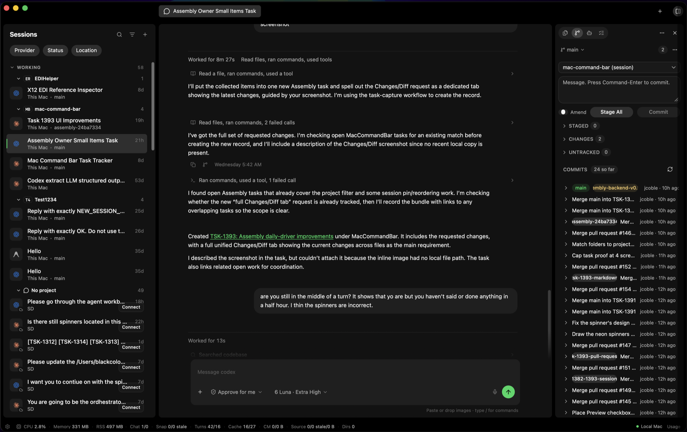

# Assembly

**A fast, lightweight desktop workspace that is half AI agent chat and half IDE.**

Assembly puts your coding-agent conversations and your project in one window. You talk to Codex, Claude Code, or Antigravity in a chat built for long agent sessions. You read, edit, diff, commit, and ship the result without switching to another tool. The editor is light by default. Turn on **Supercharged** and it starts language servers for diagnostics, go-to-definition, and reference counts.

Assembly runs on your Mac. You can also keep projects, Git, agent sessions, and the provider CLIs on a remote Linux machine and use the Mac app as the client. An Android phone app can watch and steer work on those machines.

> Assembly is under active development. The GitHub repository still carries its original name, `mac-command-bar`. The app is built with Tauri 2, Svelte 5, TypeScript, and Rust.

[Releases](https://github.com/jcoble/mac-command-bar/releases) · [Issues](https://github.com/jcoble/mac-command-bar/issues) · [Architecture guide](main-architecture-explained.html) · [Code map](docs/code-map.html) · [Contributing](CONTRIBUTING.md)



## Contents

- [Install and update](#install-and-update)
- [The Mac app](#the-mac-app)
- [Providers and sign-in](#providers-and-sign-in)
- [Utility model](#utility-model)
- [Helper sessions](#helper-sessions)
- [Workflows](#workflows)
- [History and importing past sessions](#history-and-importing-past-sessions)
- [Tasks panel](#tasks-panel)
- [Remote machines](#remote-machines)
- [The terminal on remote machines](#the-terminal-on-remote-machines)
- [The phone app](#the-phone-app)
- [Built to stay light](#built-to-stay-light)
- [Development](#development)
- [Project layout](#project-layout)
- [The docs folder](#the-docs-folder)
- [Status, contributing, and license](#status-contributing-and-license)

## Install and update

Signed Mac builds are published on [GitHub Releases](https://github.com/jcoble/mac-command-bar/releases) under `assembly-v*` tags. The release workflow builds on macOS only ([`.github/workflows/release.yml`](.github/workflows/release.yml)).

The app updates itself. Open **Settings → Updates**, press **Check for updates**, then **Install update**. It downloads the signed release, verifies it, installs it, and restarts. A development build (`pnpm app:dev`) has **Build latest (dev)** there instead: it pulls `main` into its checkout (refusing if the checkout is on another branch or has uncommitted changes), builds, deploys the backend to every saved machine through **Deploy from this checkout**, then quits and reopens Assembly on the new build, without the file watcher so a later pull can't restart it mid-run. If the build fails, the running app stays as it is. **Stop** ends a run, along with whatever it is running, before the restart. The log is in the app's log folder as `build-latest.log`.

The same screen updates the provider adapters, and the Codex and Claude command-line tools on this Mac, separately from the app.

GitHub features need an authenticated [GitHub CLI](https://cli.github.com/) (`gh`) on the machine that owns the repository.

## The Mac app

**Agent conversations**

- Codex, Claude, and Antigravity run through Agent Client Protocol (ACP) adapters that ship with the app.
- Pick the model, effort, and permission mode for each session. The menus show what the running adapter offers. Attach images.
- Send a message while a turn is running to steer it. Approvals, permission requests, and questions from the agent appear in the conversation.
- Tool calls, file edits, plans, and reasoning stream into the timeline. Each turn lists the files it changed.
- The **Context** tab shows a session's model, effort, access mode, and token use.
- The command palette opens with **⌘K** or **⇧⌘P**.

**Editor**

- CodeMirror 6, with syntax highlighting, project search, file history, and image preview. Markdown files switch between Source and a rendered Preview (GitHub alerts, footnotes, KaTeX math, Mermaid diagrams).
- **Supercharged** is a switch in **Settings → General**. With it on, a language server starts when you open a supported file: C# (Roslyn), TypeScript and JavaScript, and Rust (rust-analyzer), each with its own switch. With it off, no language server runs. One project owns the language servers at a time.

**Source control, worktrees, and pull requests**

- **Source control** covers stage, unstage, discard, commit, amend, branches, stashes, fetch, pull, push, publish, and per-file history. It can add a remote and turn a plain folder into a Git repository.
- **Worktrees** lists a project's worktrees and creates new ones.
- Pull requests are listed, read, and reviewed in a full-width diff viewer with unified and side-by-side views. GitHub actions go through `gh`, so your permissions and branch rules apply.

**Browser, terminal, and processes**

- The built-in browser is a native web view for local dev servers and websites. You can mark up a page (element, region, or freehand) and send it to the agent.
- The **Terminal** tab runs a shell for the session's folder, on the Mac or on the session's remote machine. See [the terminal on remote machines](#the-terminal-on-remote-machines).
- **Run** stores per-project commands with shortcuts and shows running processes and their output.
- The Resource Manager shows memory, CPU, and disk use, and can stop processes after a confirmation. **Usage** shows quota, tokens, and estimated cost built from the providers' local logs.

## Providers and sign-in

| Provider | Adapter that ships with the app |
| --- | --- |
| Codex | `codex-acp` |
| Claude | `claude-agent-acp` |
| Antigravity | `agy-acp` |

Assembly does not hold your provider credentials. You sign in with the provider's own tools, and access and billing stay with your provider account.

- If a provider asks you to sign in and its adapter offers a sign-in that Assembly can start, Assembly starts it. Otherwise it shows "needs you to sign in". Sign in with the provider's CLI on the machine where the session runs, then send again.
- A remote backend never opens a browser sign-in on the remote machine. Sign in with the CLI there (over SSH).
- The adapters are built and signed by the `provider-updates` workflow ([`.github/workflows/provider-updates.yml`](.github/workflows/provider-updates.yml)) and can be updated per machine without a new app release.

## Utility model

The Utility model is a small one-shot model call for three jobs: naming a session, answering **Inspect** questions about text, and drafting a pull request review for you to edit and post.

Set it in **Settings → Utility model**: choose the service (Anthropic through the `claude` CLI, or OpenAI through the `codex` CLI), the connection, and the model. The default connection is the signed-in CLI. An API key is used only if you choose the API connection and save a key there. **Test** checks the setup. Antigravity cannot be the Utility model.

## Helper sessions

A helper is a Codex or Claude session that another session starts to do part of the work. It appears in the Agents tab and under its parent in the session list, and its final reply is sent back to the parent as a message. A helper has its own chat. **Open chat** in the Agents tab opens it so you can talk to it directly.

A session can have at most 3 unfinished helpers, and helpers cannot start helpers. The **Messages** screen lists the messages that agents send each other.

Agents reach these functions through an MCP tool server that Assembly runs on each backend (`list_sessions`, `send_message`, `message_status`, `start_session`, plus the workflow tools below).

## Workflows

A workflow is a YAML file in `.assembly/workflows/` in a project, plus prompt files beside it. It lists steps and what each one waits for. A step is an agent, a list of shell commands, a review by a fresh agent, or an approval gate. A failed check or review can send work back to an earlier step, and repeated findings pause the run for you.

- Start a run from **Agents → Workflows → New**: pick a workflow file and give it a task key, title, and description. An agent can also start one with the `start_workflow` tool.
- In a run you can pause, resume, approve a gate, ask for another round, retry a failed step, or stop. The run view shows each step, its attempts, check results, and review rounds.
- Agents write and check workflow files with the `workflow_format` and `check_workflow` tools. The file format is in [docs/workflows/format.md](docs/workflows/format.md).
- This repository's own workflows are [`.assembly/workflows/dev-pipeline.yml`](.assembly/workflows/dev-pipeline.yml) and [`.assembly/workflows/spec-to-pr.yml`](.assembly/workflows/spec-to-pr.yml).

## History and importing past sessions

The **History** tab lists sessions found on disk. It reads the logs that Codex (`~/.codex/sessions`) and Claude Code (`~/.claude/projects`) write. Switch the scope between **Workspace**, **Project**, and **All**. Sessions are grouped by machine.

- **Resume as Assembly Session** imports the transcript and continues it with the provider's original session ID, so the agent keeps its own context.
- **Copy resume command** copies a command to continue in a terminal: `codex resume <id>`, `claude --resume <id>`, or `agy --conversation <id>`.
- Importing Antigravity transcripts written outside Assembly is not supported. Antigravity sessions started in Assembly resume normally.

## Tasks panel

The **Tasks** tab shows tasks from a Notion database. **Connect Notion** signs in with Notion OAuth (the sign-in service is in [`infrastructure/notion-oauth/`](infrastructure/notion-oauth/)). You can filter by status and priority, read a task's page in the app, and change its status without opening Notion.

## Remote machines

Every project belongs to a machine. A local project uses the Rust backend inside the app. A remote project uses the Assembly backend on a Linux server. It is the same Rust program as the desktop app, started with `--assembly-server` and no window.

```text
 Your Mac                                         Linux server (x86-64)
┌───────────────────────────┐   SSH tunnel   ┌────────────────────────────────┐
│ Assembly desktop app      │ ─────────────▶ │ assembly-remote-server         │
│  UI, editor, local cache  │   WebSocket    │  (systemd user service,        │
│  of remote history        │ ◀───────────── │   listens on 127.0.0.1:7777)   │
└───────────────────────────┘                │  agent sessions + providers    │
                                             │  files, search, Git, terminals │
                                             │  GitHub PRs, sessions.db       │
                                             └────────────────────────────────┘
```

- **Add a machine** in **Settings → Connections → Install a remote machine**: enter a name and an SSH destination (`user@host` or an SSH alias), then press **Install and connect**. Assembly uses your system `ssh` with key login. It downloads the latest signed backend onto the server, checks its signature and checksum, installs a user-level systemd service (`assembly-remote.service`), opens the tunnel, and connects.
- **Saved machines** can **Connect**, **Disconnect**, **Edit**, **Remove**, **Check for backend updates**, **Update**, and **Uninstall** (keeping or deleting the server's data).
- **Everything runs on the server:** agent sessions, the provider CLIs and their logins, the repository, Git, worktrees, terminals, and GitHub calls. The Mac runs only the interface.
- **History is cached on the Mac**, so remote chats stay readable offline. When the connection returns, the Mac catches up from the last saved row.
- **The app and the backend must speak the same protocol version** (`PROTOCOL_VERSION` in [`remote/mod.rs`](tauri-svelte-preview/src-tauri/src/agent_conversation/remote/mod.rs)). If they differ, update the backend from the same screen.
- **Server requirements:** Linux x86-64 with `systemd`, Python 3.9 or newer with SSL, and `sha256sum`, `openssl`, `install`, `ss`, `awk`, and `grep`.
- **What gets installed:** the binary at `~/.local/bin/assembly-remote-server`, configuration in `~/.config/assembly/server.env`, and data under `~/.local/share/assembly`.

For testing, the repository has a disposable remote machine, "Workbox Test" ([`tools/workbox-test/README.md`](tools/workbox-test/README.md)).

## The terminal on remote machines

For a session on a remote machine, the **Terminal** tab runs its shell on that machine, in the session's folder. There is no second SSH login: the keystrokes and output travel over the same WebSocket as the chat. Closing the tab leaves the shell running, and reopening it replays recent output. When the backend restarts, its shells end. Details, limits, and where to look when it breaks are in [docs/remote-terminal.md](docs/remote-terminal.md).

## The phone app

[`mobile/`](mobile/) is an Android app written in Flutter. It connects to a remote backend only, never to the Mac app. From the phone you can chat with any session on the machine, follow and control workflow runs (pause, resume, stop, retry a failed step), answer the inbox, read and edit session files, use Source control, and use a terminal. It can send push notifications when a reply is ready or something needs you.

- The backend serves the phone on a separate listener (`/phone/v1`). It is off unless `ASSEMBLY_PHONE_BIND` is set, and it cannot reach the desktop's full-control socket.
- Pair a phone from **Settings → Connections**: connect the machine, press **Pair phone**, and scan the QR code. The machine's `~/.config/assembly/phone.env` must set `ASSEMBLY_PHONE_BIND` and `ASSEMBLY_PHONE_URL` (the HTTPS address the phone uses; the design uses Tailscale).
- The Mac app's own local backend has no server, so the phone cannot pair with it.

Build and install steps are in [mobile/README.md](mobile/README.md). The design is in [docs/superpowers/specs/2026-10-12-tsk-1416-phone-app-design.md](docs/superpowers/specs/2026-10-12-tsk-1416-phone-app-design.md).

## Built to stay light

Assembly exists because similar tools are slow and heavy. Every change is judged against memory and speed ([AGENTS.md](AGENTS.md)). The main techniques:

- **Rust does the heavy lifting.** Git, files, search, terminals, process sampling, language servers, and the SQLite session store run in the Rust backend, not the web view.
- **Idle agents cost nothing.** An adapter process runs only while a turn and its follow-up work are active. When everything is quiet, the process stops. The next message resumes the same provider session.
- **Language servers only on request.** They run only while Supercharged is on.
- **Event-driven, not polling.** `pnpm --dir tauri-svelte-preview test:async-lifecycle` checks every timer in the frontend against an allow-list.
- **Animations must end.** A looping animation is allowed only while real work is happening. CSS `:has()` is banned.

Measure memory in Activity Monitor, because the Web Inspector inflates it. One measured checkpoint is in [the September reliability pass](docs/reports/2026-09-13-assembly-reliability-hardening.html).

## Development

### Requirements

- macOS with the Xcode Command Line Tools (to run the desktop app)
- Node.js 22 and pnpm 10.28.2
- Stable Rust and Cargo
- [Bun](https://bun.sh), used to compile the provider adapters
- Git, plus the provider CLIs you want to use

### Run the app

```sh
git clone https://github.com/jcoble/mac-command-bar.git
cd mac-command-bar
git config core.hooksPath .githooks
pnpm --dir tauri-svelte-preview install --frozen-lockfile
pnpm app:dev
```

`pnpm app:dev` runs `tauri-svelte-preview/scripts/dev-app.sh`. It prepares the provider adapters if they are missing, starts Vite on `127.0.0.1:5177` (or attaches to one already running from this checkout), builds the Rust app, and opens Assembly. Frontend edits reload on their own. After Rust changes, stop it with **Ctrl+C** and start it again.

On `main`, `pnpm app:update` pulls with fast-forward only, installs the locked dependencies, and launches the dev app.

### Package the app

```sh
pnpm --dir tauri-svelte-preview tauri:build
```

A full build expects a Tauri signing key in `TAURI_SIGNING_PRIVATE_KEY`, because updater artifacts are on. Official releases come from [`.github/workflows/release.yml`](.github/workflows/release.yml).

### Tests and checks

```sh
pnpm --dir tauri-svelte-preview check   # svelte-kit sync, tsc --noEmit, cargo check with warnings as errors
pnpm --dir tauri-svelte-preview build   # production frontend build
cargo test --manifest-path tauri-svelte-preview/src-tauri/Cargo.toml
(cd core && cargo test)
```

Focused logic tests are the `test:*` scripts in [`tauri-svelte-preview/package.json`](tauri-svelte-preview/package.json). Run the tests for the area you changed rather than the whole suite.

### Commit checks

`git config core.hooksPath .githooks` turns on two hooks. They run [`tauri-svelte-preview/scripts/commitChecks.ts`](tauri-svelte-preview/scripts/commitChecks.ts) and the async lifecycle scanner. A commit is stopped for:

- a staged `.rs`, `.ts`, or `.svelte` file over 600 lines (older large files are listed in `tauri-svelte-preview/scripts/commitChecks.baseline.json` and may not grow);
- a new branch on a provider name (`codex`, `claude`, `antigravity`) outside `tauri-svelte-preview/src-tauri/src/agent_conversation/providers/` and tests;
- a `fix` commit that changes no test and has no `No-test: <reason>` line;
- recreating a removed file location, or importing another feature's internal files;
- a message that has a `Co-Authored-By` line or does not end with `Committed-by: <name>`, or, on a `tsk-NNNN` branch, lacks a `Task: TSK-NNNN <Notion URL>` line;
- a commit that neither stages `main-architecture-explained.html` nor says `Architecture: unchanged`.

[CONTRIBUTING.md](CONTRIBUTING.md) has the commit message format and pull request rules.

### Proving a change: the four-scenario check

Every change must be shown working in the running native app for Claude Code and Codex, each on a local session and on a remote session on Workbox Test. [docs/operations/four-scenario-check.md](docs/operations/four-scenario-check.md) describes the script that sets up and tears down the test app, the steps for each scenario, and the report table.

### Build the remote backend

The backend package must be built on Linux x86-64. The packaging script refuses to run elsewhere. With Node 22, pnpm, Bun, and stable Rust installed on Ubuntu 24.04:

```sh
sudo apt-get install -y libwebkit2gtk-4.1-dev libayatana-appindicator3-dev librsvg2-dev patchelf
cd tauri-svelte-preview
pnpm install --frozen-lockfile
pnpm build
cargo build --locked --release --manifest-path src-tauri/Cargo.toml --bin mac-command-bar-webview-preview
pnpm prepare:remote-backend-package 0.0.0-dev
```

The package is written to `tauri-svelte-preview/remote-backend-release/`. To install a build you made yourself, copy the archive to the server, extract it, and run its `install.sh`.

**Install and connect** installs only signed releases from this repository. [`.github/workflows/release-remote-backend.yml`](.github/workflows/release-remote-backend.yml) publishes them when backend changes land on `main`, or when an `assembly-backend-v*` tag is pushed.

To try your current checkout (including uncommitted changes) on a machine, run `cd tauri-svelte-preview && pnpm deploy:remote-backend-dev <ssh-host>`. It builds on that host, replaces only the service binary, and records a development manifest. A development app also shows **Deploy from this checkout** in Connections. More in [docs/backend-update-process.html](docs/backend-update-process.html).

## Project layout

[docs/code-map.html](docs/code-map.html) is the full map of what lives where. The short version:

| Path | What it holds |
| --- | --- |
| [`tauri-svelte-preview/`](tauri-svelte-preview/) | The desktop app and remote backend. The folder keeps its early prototype name. |
| [`tauri-svelte-preview/src/lib/shell/`](tauri-svelte-preview/src/lib/shell/) | Svelte 5 frontend, one folder per feature (conversation, files, git, terminal, browser, workflows, history, settings). |
| [`tauri-svelte-preview/src-tauri/src/`](tauri-svelte-preview/src-tauri/src/) | Rust backend, one folder per feature, plus `agent_conversation/` (sessions, providers, remote, phone). |
| [`core/`](core/) | `mcb-core`, a Rust crate: the SQLite session store and the session and disk scanners. |
| [`mobile/`](mobile/) | The Android phone app (Flutter). |
| [`infrastructure/notion-oauth/`](infrastructure/notion-oauth/) | The Notion sign-in service (Cloudflare Worker). |
| [`scripts/`](scripts/) | Building and updating the Mac app (`app:update`). |
| [`tools/workbox-test/`](tools/workbox-test/) | The Workbox Test machine used for remote tests. |
| [`.assembly/workflows/`](.assembly/workflows/) | This repository's own workflow files. |
| [`docs/`](docs/) | Guides, plans, and reports (index below). |
| [`Sources/`](Sources/), [`Tests/`](Tests/), `Package.swift` | The original Swift menu-bar app, kept for reference. It is not part of Assembly. |

[`main-architecture-explained.html`](main-architecture-explained.html) is the one maintained description of how Assembly works: process boundaries, provider adapters, the session lifecycle, storage, wire formats, and remote execution. Any change to what it describes updates it in the same commit.

## The docs folder

| Path | What it is |
| --- | --- |
| [`docs/code-map.html`](docs/code-map.html) | Where each feature lives, the boundary rules, and what changed in October 2026. |
| [`docs/operations/four-scenario-check.md`](docs/operations/four-scenario-check.md) | The test procedure for chat changes. |
| [`docs/remote-terminal.md`](docs/remote-terminal.md) | How the terminal works on a remote machine. |
| [`docs/workflows/format.md`](docs/workflows/format.md) | The workflow file format, also served to agents by `workflow_format`. |
| [`docs/backend-update-process.html`](docs/backend-update-process.html) | How the desktop, backend, adapters, and CLIs are developed and updated. |
| `docs/superpowers/specs/`, `docs/plans/` | Design specs and implementation plans for features. |
| `docs/reports/`, `docs/research/` | Investigation reports and research notes. |
| `docs/codebase-map/` | Older module notes. Many paths in them no longer exist; use the code map instead. |
| `docs/*.html` | One-off design pages for individual tasks. |

## Status, contributing, and license

Assembly is used daily by its author and changes quickly. Known limits today:

- Desktop releases are built for macOS only (development builds also run on Linux, which is how changes are tested on remote machines). The remote backend targets Linux x86-64 only.
- Importing Antigravity history written outside Assembly is not supported.
- The phone app is Android only and is built from source.

Work is tracked in [GitHub Issues](https://github.com/jcoble/mac-command-bar/issues). Contributions are welcome: keep pull requests focused, run the checks above, and treat memory and speed as part of correctness. [CONTRIBUTING.md](CONTRIBUTING.md) covers setup and how to report bugs.

Assembly is licensed under the [Apache License 2.0](LICENSE). Parts of the conversation interface adapt presentation patterns from [T3 Code](https://github.com/pingdotgg/t3code) (MIT); see [THIRD_PARTY_NOTICES.md](THIRD_PARTY_NOTICES.md). Assembly is built on [Tauri](https://tauri.app), [Svelte](https://svelte.dev), [CodeMirror](https://codemirror.net), [Ghostty Web](https://github.com/coder/ghostty-web), and the [Agent Client Protocol](https://agentclientprotocol.com).
