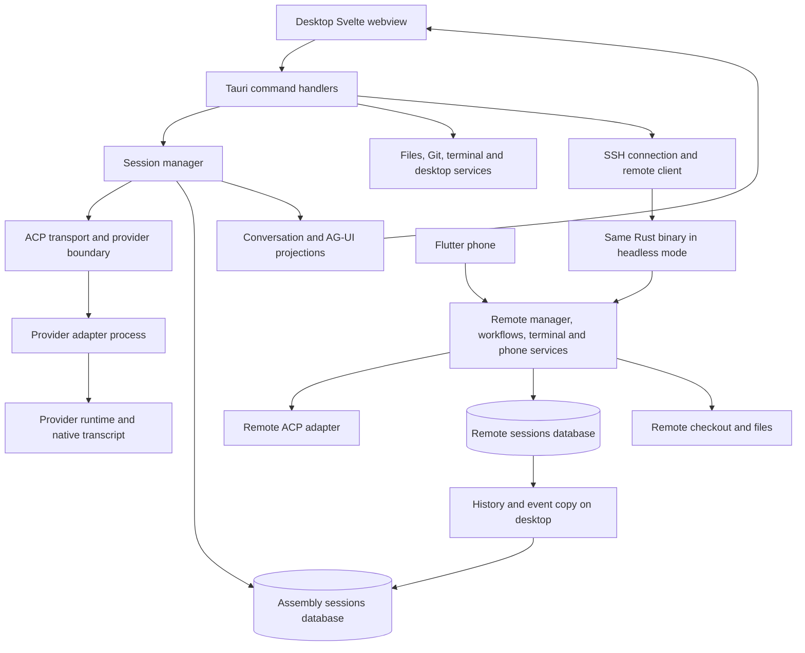
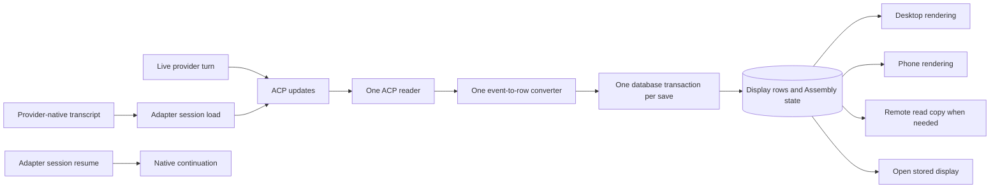
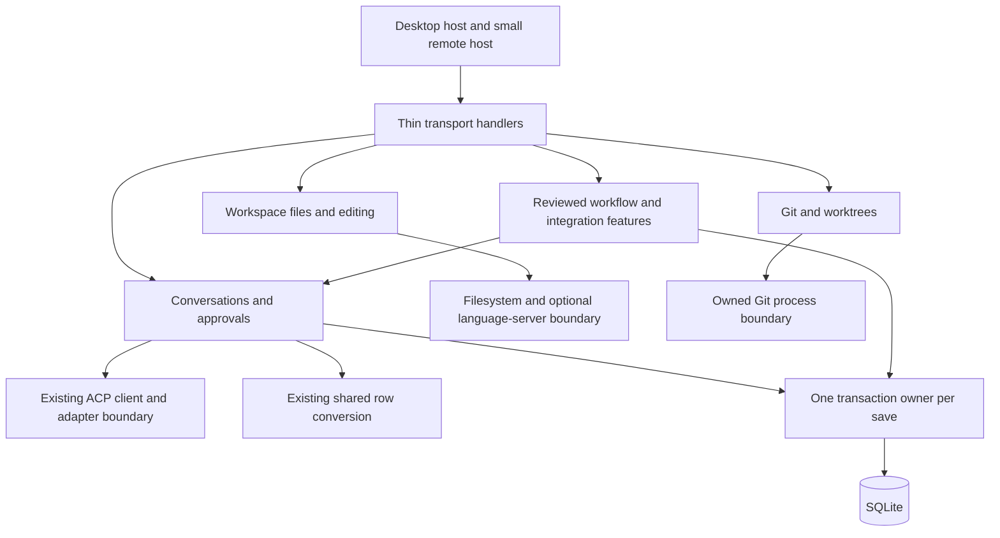

# Assembly backend refactor assessment

## Clarifying questions

These questions record decisions for Jesse to resolve before the implementation plan. They do not block this assessment. The agreed direction is a redesign around the .NET spike, ACP, atomic saves, and a smaller remote backend; it is not a line-for-line Rust port.

### Already answered by Jesse (2026-10-24, in his words)

Only items Jesse stated himself are listed here. Everything else in this document is a recommendation or an open question. Times are from the TanstackAISpike project conversation.

| Topic | Jesse's words or choice | Effect on this assessment |
| --- | --- | --- |
| Chat path | Picked option B on a decision card (07:59): the machine that runs the agent converts ACP into rows once (local sessions on the Mac, remote ones on Workbox); each machine saves rows in SQLite with one seq per session; raw ACP never goes into a database; the Mac copies remote rows by seq and pushes them to the UI, which only draws; the phone reads the same rows from Workbox; rows carry a format version. | Settles conversion placement and the remote chat wire. The "choose events or rows at cutover" question is closed: rows. |
| Rows stay | 17:07: "i decided i want to keep the rows how we had them" ("mem staying low is a big one"). 17:09: "But I want to do everything else through the acp adapter though". | SQLite rows are for display only. Sessions, resume, list/load, fork and rewind go through ACP with the same native ids. |
| Parity | "it doesn't have to do everything the same, just work, low mem, understandable and extensible." | Confirms "not a 1:1 port". Each feature still needs a keep/change/retire call. |
| Where the logic lives | "the mac's backend is where most the logic actually lives." The remote was added later and isn't "a copy of the app" with "all the UI stuff". | Supports a small remote composition that runs agents, rows and only the services that must sit beside remote files. |
| Core plumbing first | 17:44: "maybe it's the time to just get all the core feature of chat and other things in. Just the plumbing? And make sure that we get it setup so it's basically provider agnostic. We could make sure we have codex working too." 18:13: "But actuall sub-agents though as well". Steering: "super important". | Native subagents, steering, Codex beside Claude Code and the rest of the chat plumbing are retained requirements, not optional extras. |
| Language servers | "this was supposed to be both" (local and remote projects get full language servers). | Full semantics for remote projects is a requirement. Only *where* the server runs remains open (row below). |
| ACP version | "But we don't need that then now" (about ACP v2). | Build on ACP wire version 1. |
| Code structure | Even 600 lines per file is too much; code organized by feature, one class per file, small classes with one job each. | Applies to the new C# code. It does not justify wrapper classes or interfaces with no second use (see Rules). |
| Session handoff | 17:15: a wish for "handing off a session to remote and back". 20:41: "would love to have them but they are not a big concern as of now." | Not scheduled. Keep the schema from blocking it: a thread's machine can change, native ids survive a move, one writer per thread. |
| Session lifetime | 20:41: "agent sessions should just stay open as long as there is no subagents, (orchestrators - stay open if they have their helpers running, and stay open if workflows they are delegating are open) and they are done with their turn." | **Reading used here (Jesse to correct if wrong):** an ACP session stays open while its turn, its native subagents or background work, or (for an orchestrator) its running helpers or delegated workflows are still going. When all of those are done, it closes. This replaces the spike's close-at-prompt-end. |
| Rewind and fork | 20:41: "Rewind we can hold on". "Fork only if it's not hard." | Rewind is out of the first release. Forking a whole session is one ACP call (Claude ACP serves `session/fork`, unstable; Codex advertises `fork`) plus copying the thread's rows, so it is likely small. Forking at a chosen message uses a JetBrains AIR `_meta` field on the Claude fork request and needs the copied rows cut back to that message, so it is more work. |
| ACP v2 | 20:41: "I guess it's prob good if we just have v1 working first. We don't want to make this port too complicated." (T3 Code already has v2.) | v1 only. The `Acp/V1/UpdateReader` seam keeps a later v2 reader beside it. |
| Remote keeps working | 20:41: "workflows def should keep running if on the remote. Same with push notifications, if it's on the remote". "if their's tings running on the remote, shouldn't matter too much if my laptop is closed. That's one of the points of doing remote machines." | The remote host owns workflow execution, push and phone access for its own sessions, with no dependence on the Mac. |
| Local work while the Mac is closed | 20:41: local workflows and push "wold mean i have to keep it running. Maybe that could be a setting?" | A "keep the Mac awake" setting is Jesse's idea, not yet a decision. macOS limits what an app can do once the lid closes; part of the research below. |
| Cross-machine messages | 20:41: "we have that now, and should be in product. I need the agents to be able to communicate across devices" (testing something from the Mac, needing a file from the Mac, a Mac session and a remote session talking back and forth). | Retained requirement. Today they relay through the connected Mac (`remote/server/mod.rs:63`). Messages between sessions on the same remote must not need the Mac; a message to a sleeping Mac waits until it reconnects. |
| Auto-connect | 20:41: "Auto connect is a requirement. It's just loading the remote connection up on app start." | Requirement. Today saved machines stay dormant until Connect (PDF p. 2). |
| Codex plugins and tools | 20:41: "The plugins should be loaded i'm thinking, we had them before." Computer use wanted. Agents "should get at lesat the basic ones to be able to carry out their tasks." | Load the user's Codex plugins (including the bundled computer-use one). The MCP-server part is still open (below). |
| Antigravity and more adapters | 20:41: "I'd like to get agy working, because I'd like to use gemini and the new model for sub agent work. I have 2 accounts that i could use." Later: "more just adding the provider rather than a whole new integration." | Antigravity is retained. Two accounts means two descriptors with separate homes/logins; the spike's per-descriptor pool already keeps them apart. A new ACP adapter should need only a descriptor plus evidence-backed differences. |
| Native host needs | 20:41: browser "pretty darn important to me"; "Clipboard is iimportant too for sure"; notifications "a lower priority or nicety"; keychain and packaging "we need a away somehow". | Browser and clipboard are requirements. The host itself was decided at 22:13 (next row). |
| Native host | 22:12: Photino's appeal was .NET profiling, "But, thinking about the tauri, we get rid of the tauri listeners first off. Or just use them for the native stuff if we have to." "Maybe the better option IS to bring over the front end feature by feature. And get the code cleaned up and performant, see where the bottle neck is". 22:13: "I'll go w that." to the shape proposed in [Research Mac native pieces for C# port](https://claude.ai/artifact/Qb9StKMxvQ2UHuyq3CLFuD). Blazor Hybrid rejected ("bloated all to hell"). | **Decided: thin Tauri shell + separate .NET backend.** The Rust shell owns only the window, browser tabs (Tauri `add_child`, which Assembly's browser already uses) and native calls, with no app event listeners. The .NET backend runs as its own process (so Rider/Visual Studio profile all app logic) and the UI talks to it over a websocket. The front end is ported feature by feature, each with a lag-meter run before it counts as done. Photino/PhotinoX is dropped, so the spike's `Spike.Mac window` (backend and Photino in one process) is superseded; its backend half stays. The research thread suggests Keychain and keep-awake can live in C#; that is a recommendation, not Jesse's decision. |
| Features kept and dropped | 20:41: "Have to get rid of the workflows panel, but not workflows themselves, it got moved to a big window". "Inbox tab i think goes. And the rest of everything stays." Messages "need a litte UI work but are good". Session grouping in the UI "needs a little work, but shouldn't effect the backend too much". "All the stuff in settings." Remote Run: "not huge, but shouldnt be that hard." | Drop: the right-panel Workflows tab and the Inbox tab. Keep: everything else, including the full Workflows screen, Messages, Build Board, Settings (connections, updates, pair phone, adapters and CLIs), browser, Run (remote Run is a small later item). |
| Existing data | 20:41: "Existing data does not matter at all." | **No migration.** No import of old events, no old wire versions, no cutover tooling. |

### Still open

| Decision | Current evidence and recommended starting point | What the answer changes |
| --- | --- | --- |
| Do drafts need to follow a session to the phone? | A draft is a message typed into the composer but not sent. For a remote session, Assembly saves it on the remote today (`SetDraft`, PDF p. 2), so the phone could show the same unsent text. **Recommendation:** keep that: save a session's draft on the machine that runs the session. It is one place, and the phone already talks to that machine. Layout, open tabs, cursor and Files-tree expansion stay on the Mac. | Where the drafts table lives. |
| Should Codex sessions load the user's own MCP servers? | Assembly loaded them all along: it launches codex-acp with the user's `~/.codex` config and only merges its own `assembly` server settings into `CODEX_CONFIG` (`providers/process.rs:353-392`, `providers/descriptors.rs:19`). The cost existed before; it was less visible because Assembly stopped an adapter after about 30 s of quiet and Activity Monitor lists those processes apart from the app. The spike turned them off (`agents-file.sh:6-9`) and measured about 0.5 GB per loaded Codex session with them on. **Recommendation:** load them as Assembly did, measure with the new session-lifetime rule, and add a per-agent list of servers to switch off only if the numbers are bad. | Memory per Codex session and which tools agents see. Assembly's own MCP server is injected separately (spike passes an empty `mcpServers`, `AcpClient.cs:60`, `:69`). |
| How long does the shared adapter process stay up once no session is open? | The session rule above is settled. For the process under it, Assembly never keeps idle adapters alive (`AGENTS.md:39-41`); the spike waits `SharedAdapter.IdleGrace` = 60 s (`SharedAdapter.cs:18`). **Recommendation:** keep a short grace (it avoids a cold start on a quick follow-up) and measure; it costs about 80 MB per idle adapter, not a full session. | One constant. |
| Where does the language server for a remote project run? | Requirement settled ("both"). **Recommendation:** on demand, on the remote machine beside the checkout, SDKs and dependencies, with the Mac editor as its client. Running it on the Mac would need a project mirror. | Remote host composition and memory. |
| Should Usage show the remote machines' usage? | Each machine keeps its own usage store; the view shows only the Mac's (PDF p. 10). | Whether the remote host exposes a usage read. Small. |

## Purpose, rules and evidence

**Assessment for review, 2026-10-24. No backend implementation is changed by this document.** A second pass (notes near the end) checked it against spike `d9856bc`; Jesse reviews it before it becomes a detailed implementation plan.

Being able to read and maintain the backend in C# is a concrete reason for this change. Use the existing .NET 10 spike as the baseline; evaluate a later runtime against the same behavior and performance checks when it is selected. The reported JIT/AOT results are encouraging, but the migration should not depend on a prediction that the full application will match a particular Rust memory number.

Jesse's current instructions govern the design:

- This is a cleanup and redesign, not a 1:1 port. Preserve required user behavior; reconsider every mechanism used to provide it.
- Let ACP and its adapters do work they already support. Keep Assembly-specific product behavior in Assembly.
- Keep the ordinary session path provider agnostic. Differences belong at the adapter boundary and need evidence.
- **Every logical database save is atomic.** One statement may be sufficient. Multiple statements that form one save must use one transaction on the same connection; all succeed or none do. Several repository methods or connections do not become atomic just because they share a file or a lock.
- **One implementation per behavior.** Different transports may call the same operation. Local and remote databases may hold authoritative data and a read copy. Neither justifies a second business implementation, a second transcript parser, or two active save paths.
- Keep the remote host small. Put desktop work locally; put only necessary execution and access to remote resources beside those resources.
- Use SOLID to clarify responsibilities and dependencies. Organize by feature, one class per file, small classes with one job (Jesse's stated preference above). Do not add interfaces, base classes, factories, tiny wrapper objects or projects to satisfy a pattern. Splitting a file by line count alone does not create a clear owner; splitting by responsibility does.

The first pass used the explicitly requested [SOLID skill][solid-skill], with Jesse's KISS/YAGNI rules taking precedence over its more prescriptive wrapper advice. The second pass (below) did not re-read that skill.

### Source snapshots and limits

| Material | Snapshot | How it was used |
| --- | --- | --- |
| Assembly Rust | `20892903` at the start of assessment | Inventory of `core/src` and `tauri-svelte-preview/src-tauri/src`; focused source reads of lifecycle, storage, transport, history, files, Git and supporting services. |
| Latest .NET spike | `/Users/blackcolours/dev/work/worktrees/TanstackAISpike/dotnet`, branch `spike/dotnet`. First pass: `c8dc225` through `6e1301a`. **Second pass: `d9856bc81767f3634a36b333cf527844121ba28f`** (read from `git archive`, so later edits in the worktree did not leak in). | All `spike-*` links below now point at `d9856bc` line numbers. `6e1301a` (“wip: session config (unverified)”) is no longer on the branch; `b3a9d04` replaced it. At the time of reading, the only uncommitted changes were in `Spike.Remote/Record/` (test scenarios for background work, in progress, not reviewed). The base checkout's `spike/agent-server` branch is older. |
| Supplied feature review | [Claude.pdf][feature-pdf], 11 pages, created 2026-10-24 from Assembly `main` `2089290` | Read all rendered pages in both passes. Used as the feature checklist and prior discussion record. It labels each fact (code) or (doc); (doc) items were not re-checked against code there. Its suggestions and quoted earlier requests are context, not new authorization. |
| Existing architecture notes | `main-architecture-explained.html`, `docs/codebase-map/` | Orientation only where not freshly checked. Several references use old file locations or line numbers. Current source wins. |
| Earlier ACP tests in this conversation | [Shared-pooling guide][pool-guide] and its linked isolated test results | Evidence about the tested Codex adapter, concurrency and cancellation. Those tests do not prove the .NET integration already behaves the same. |

This is an architecture and migration assessment, not a security audit or a claim that every function has been reviewed. All Rust source files in the two source roots were inventoried; consequential findings below have source anchors. No app launch, build, owner-data mutation or new live-provider test was performed for this assessment. The supplied memory measurements remain Jesse's reported soak results, not measurements reproduced here.

**What the spike added between the two passes** (project records say `9d9c589`, `c8dc225`, `b3a9d04`, `d01dc31` and `d9856bc` were checked in the real window on Jesse's Mac, with screenshots under `notes/evidence/mac-host/`; this review itself read source only):

| Commit | Behavior | Effect on findings |
| --- | --- | --- |
| `c8dc225`, `2421215` | Agents as descriptors (`agents.json`), one `SharedAdapter` per agent per machine, Codex ACP **2.2.2** beside Claude ACP **0.94.0**; Codex opts into the AIR `sessionIndex` extension and its sessions are titled from the first message. | Pooling is by descriptor id, unconditionally. |
| `b3a9d04` | The agent's own config menus (model, effort, mode), chosen per thread and reapplied on every session open. `config_option_update` is read. | Config is now a committed feature, not "wip". |
| `d01dc31` | Permission requests and `elicitation/create` forms become card rows answered in the thread; Stop settles open cards as cancelled. The client-wide fallback is `UnclaimedPermissions`, which cancels. | **Resolves** the automatic-acceptance finding. `AllowOncePolicy` remains only in the `Spike.Remote/Smoke` test command. |
| `d9856bc` | Plans and todos reach the thread from both agents. | Plan rows exist; the env flags that enable them are in `agents-file.sh:10-11`. |
| Earlier: `9d9c589`, `6d21f08`/`bcb4eb2`, `2da7abf`/`39a048a`, `5bbba47` | Steering through `_session/steering`; remote threads with rows copied to the Mac over an SSH tunnel; one shutdown path on every window exit; updates for closed sessions dropped. | Steering and the remote row copy were not described in the first pass. |

The earlier isolated concurrency/cancellation proof used Codex ACP **1.13.1**; rerun that proof on the selected adapter before claiming equivalence. A package's major version is not its ACP wire version. [Current launch script][spike-launch-script], [configuration operation][spike-config].

The spike is still advancing: background work is being built in the same worktree now. Findings below describe `d9856bc`. Recheck before assigning any implementation work.

The [readable HTML copy][assessment-html] was generated from the first pass and is now stale. It lives outside the folders this review could reach, so it was not regenerated. The Markdown is the editable assessment.

## What the code establishes

1. **Build on the current .NET spike.** It already separates adapter connections, session execution, update routing, conversion to rows, SQLite, live delivery and native hosting. It also already shares an adapter per agent ID. Recreating these in another migration scaffold would introduce duplicate implementations. [Registry][spike-registry], [row converter][spike-converter], [Mac host][spike-mac].
2. **The Rust refactor did not finish moving responsibilities.** Feature command files still import business operations and types from the executable root. The session manager still combines lifecycle, persistence coordination, approvals, background work, native history, helper behavior and provider details. This is more consequential than whether a file crosses 600 lines. [Git commands][rust-git-commands], [file commands][rust-file-commands], [managed session][rust-managed-session].
3. **Keep the good transactional behavior.** Rust already commits an event and its session row together and only then updates its candidate state and publishes. The .NET row batch also commits rows, sequence allocation, tool details and delta removal together. Preserve these guarantees while reducing the machinery. [Rust commit][rust-store-commit], [state apply][rust-candidate-apply], [spike row commit][spike-row-commit].
4. **Neither existing backend should be copied unquestioningly.** The spike has metadata writes on a second connection, broad resume-to-new-session recovery, a per-turn session close that will cut off background work, a page query that scans the whole thread, and no list/load/fork in its ACP client. (Its automatic permission acceptance is gone since `d01dc31`.) Rust's history rebuild has separately committed deletion and replacement metadata. These need explicit treatment before migration. Evidence is detailed below.
5. **Smaller remote means a separate composition, not a second session engine.** The new `Spike.Remote` already composes just the session/row/API services. The old Rust binary has a headless entry mode, but that mode does not start every desktop feature. Separate compiled dependencies, instantiated services and child-process memory when assessing cost. [Rust entry][rust-main-entry], [Rust server][rust-server], [spike remote host][spike-remote].
6. **The spike is a chat engine, not yet Assembly's session model.** Its thread knows an agent id, a repo URL, a machine and a native session id (`ThreadInfo.cs:9`), and each thread gets its own fresh clone under `checkouts/<thread id>` (`AdapterLauncher.cs:13-19`). Assembly sessions belong to a project, run in a real folder or worktree that can change, carry helper parent ids, completed/settled stamps and presence (PDF pp. 3-4, 9-10). That model has to be designed into the new schema; it does not come from the spike.

### Inventory scale

The two Rust source roots contain **177 `.rs` files and 120,252 physical lines**, including comments, blank lines and tests. **34 files exceed 600 lines.** These are discovery counts, not production-only line counts or a complexity score.

| Area | Files | Physical lines | What the count suggests inspecting |
| --- | ---: | ---: | --- |
| Conversation, providers, history, remote and phone | 79 | 52,727 | The largest ownership knot; split by reasons to change, not file size. |
| `core/session_store` and its feature files | 7 | 9,637 | Many feature queries share one large store; preserve transactions when assigning ownership. |
| Files, discovery and language servers | 13 | 11,170 | Distinguish file access, local editor intelligence and language-server processes. |
| Workflows and their tests | 14 | 8,806 | Separate scheduling/product rules from provider session transport. |
| Executable root `main.rs` | 1 | 7,331 | Still contains substantial Git/worktree/process behavior as well as composition. |
| Browser | 3 | 3,274 | Native host capability; not a remote conversation dependency. |
| Git feature files | 7 | 2,986 | Count excludes Git implementation still in `main.rs`. |

The generated handler registers **280 desktop command entries**. This is an interface inventory, not 280 independent features. Several commands are different entry points into the same responsibility. The current [commit-check baseline][size-baseline] explicitly allows existing oversized files, including `manager.rs` at 15,756 lines. The rule therefore has not made all existing source files smaller than 600 lines.

## How the current Rust backend fits together



The diagram groups responsibilities; it is not a claim that every arrow is a direct function call. `main.rs` constructs the desktop services, opens the store and joins workflow, message and projection callbacks. `--assembly-server` takes a separate entry path and constructs its own manager and store. Phone commands use the server's shared command execution. [Desktop composition][rust-composition], [headless composition][rust-server-state], [phone routes][rust-phone].

### Important data flows

| Flow | Current path | Migration consequence |
| --- | --- | --- |
| Send / steer / stop / approve | UI or phone request, machine routing, manager, ACP session, ordered updates, durable events, projections | One application operation for each behavior; transport handlers should not reimplement it. Preserve per-session ordering and request identity. |
| Open stored chat | SQLite snapshot and bounded event/item pages, then frontend timeline construction | Replace repeated client reconstruction with the agreed row path; retain bounded reads and live catch-up. |
| Import external history | Provider filesystem discovery, provider transcript parsing, import cursor and SQLite events, then ACP continuation | A major candidate for replacement by adapter list/load, after feature-equivalence probes. Do not port parser code by default. |
| Remote chat | Remote commits its events, desktop copies/caches them, desktop projects them | **Decided (option B): rows.** The remote converts and commits rows; the Mac copies them by seq (`RemoteFollower.cs:78-117`, `RowStore.Copy`) and pushes them to the UI. Existing data does not matter (Jesse), so old event history is not converted. |
| Finished Markdown | Rust parses local completed messages; headless mode skips it; remote history caching adds blocks locally | Backend work already exists. The objective is one shared conversion implementation and simple consumers, not moving a wholly nonexistent backend converter. [Current conversion][rust-markdown-step], [remote cache][rust-remote-history]. |
| Phone chat | Remote `reduce_chat` produces a separate phone representation | Option B has the phone read the same rows from Workbox, so `reduce_chat` is superseded at cutover. Untested: the Flutter client has not read spike rows yet. [Phone reduction][rust-phone-reducer]. |
| Editor save | Owner-machine file read, revision comparison, temporary file and replacement | Preserve version/conflict checks and replacement semantics. A SQLite transaction cannot atomically include a remote filesystem write. [File save][rust-file-save]. |
| Workflow turn end | Manager emits committed turn result; workflow callback advances the run and dispatches work | Preserve durable run progress and restart recovery. Do not make workflow execution a provider-client responsibility. |

## Complete feature disposition map

This table reconciles the supplied PDF's 20 numbered features with backend responsibilities. **Keep** means keep required behavior; it does not mean translate the current implementation. Proposed locations are recommendations awaiting the questions above.

| Feature from prior review | Owning code / durable state today | Assessment for .NET and placement |
| --- | --- | --- |
| 1. Session list | Manager, core session/project queries, desktop remote cache; session IDs and rail metadata | Keep stable Assembly identity separate from native session ID and process lifetime. Desktop combines lists; machine holding execution owns execution state. Provider lists discover native history, not Assembly layout or project metadata. **Missing from the spike:** the orchestrator/Working/Done/Settled grouping driven by the user's `completedAt`/`settledAt` stamps, presence (working, needs you, idle, disconnected), project grouping and archive. The spike's `thread_info` has none of these (`ThreadStore.cs:11-17`). |
| 2. Helpers and orchestrator | Manager helper operations, `messaging/mcp.rs`, core broker/helper tables | Keep Assembly's authority, permission and ownership rules: helpers can't start helpers, at most 5 unfinished helpers per session, helpers start at the parent's permission level, sibling messages capped at 20 each way (PDF p. 4, (doc)). Native provider subagents are different from independent Assembly helper sessions. Use the same session operations for helpers rather than another provider executor. **Gap:** helpers reach Assembly through its MCP server, given to each ACP session with a session-bound token; the spike passes an empty `mcpServers` list on new and resume (`AcpClient.cs:60`, `:69`). Helper `start_session` currently names a fixed provider; Jesse asked for helpers to be provider agnostic (PDF p. 4). |
| 3. Conversation | Manager, ACP client, normalization, events, AG-UI projection, attachments, safe Markdown | Use the spike's single ACP-to-rows path as the baseline. **In the spike now:** text, thinking, tools with diffs, plans, usage/cost, title, config menus, permission and question cards, steering, Stop. **Not yet:** slash commands (`available_commands_update` and `current_mode_update` are ignored, `UpdateReader.cs:29-31`), background work (in progress), native subagents, fork/rewind, drafts, and streamed tool output (a Bash tool's output arrives only at its end, seen in the remote window checks). Images go to the agent as a file path inside the prompt text, not as an ACP image content block (`AttachmentStore.cs:5-7`, `AcpClient.cs:110`); check each adapter's `promptCapabilities.image` before choosing. Simplifying cannot mean silently dropping adapter features. |
| 4. Files | `files/discovery`, `files/io`, workspace remote operations; expanded paths/workspace state | Tree layout, expansion and scroll stay on the Mac. Every file action (list a folder, read, save, create file/folder, rename, move, delete) runs on the machine that has the files, through one small set of file operations in the shared engine: the Mac calls them in-process for local projects and over the machine connection for remote ones. Rust already works this way (`remote/workspace.rs:84-106`). Do not transfer the entire project to make a local file tree. |
| 5. Source control | `git/commands`, `git/workspace`, substantial `main.rs` functions | One Git implementation on the checkout's machine, with local UI/diff presentation. Preserve argument-array invocation and stale-head/conflict checks; move logic out of executable composition when implementing the chosen feature. |
| 6. Agents panel | Helpers, provider-native child sessions, messages, workflow/inbox aggregations | **Jesse: the Workflows tab and the Inbox tab go**; Session and Messages stay. Treat helpers and native subagents as distinct relationships even if one tab shows them together. Preserve provider-native child IDs at the provider boundary. How sessions are grouped is front-end work. |
| 7. Tasks / Notion | `notion_tasks.rs`, `notion_oauth.rs`, cached SQL projections, keychain | Desktop integration. Do not load Notion OAuth, task UI or task polling into the remote host just because sessions can reference a task key. Remote workflow input can carry the required snapshot. |
| 8. Worktrees | `core/scanners/worktrees`, `project_folders`, root Git functions | Keep inspection and filesystem/Git actions beside the checkout. Local presentation and helper-generated advice remain local. Preserve project membership independently of an ephemeral worktree. |
| 9. Terminal | `terminal/mod.rs`, registry and projection streams; process memory/scrollback | Local view, shell on the owning machine. ACP tool terminals and the user's terminal are different requirements; adapter support for tools does not replace Assembly's interactive terminal. Preserve explicit ownership and close/exit handling. |
| 10. Run | Terminal `RunConfiguration`, root/runtime command handlers; saved definitions/settings | Separate saved launcher definitions from a running process. The PDF finds a local-only current path. Remote Run is wanted later (Jesse: "not huge, but shouldnt be that hard"): the process runs on the machine with the checkout, like the terminal. |
| 11. Context | Session capabilities/config, usage, attachments and file-change information | Read the shared committed state and actual provider reports. Do not infer unavailable context metrics or add another transcript reader for this panel. |
| 12. History | `core/scanners/sessions`, `history/mod`, transcript parsers, remote transcript/import operations | First test ACP list/load/resume. Retain a custom reader only for an explicitly retained feature the adapter cannot supply. Assembly's own list, archives and workspace metadata still belong in SQLite. This is browsing and resuming sessions started outside Assembly; it is not data migration, which is dropped. |
| 13. Browser | `browser/mod.rs`, native child views and profile files | **Jesse: "pretty darn important".** Desktop concern, kept in the thin Tauri shell (decided 22:13): browser tabs stay Tauri child webviews, as today. Opening a page for a remote development server is a network-access question; it does not require putting WebKit into the remote backend. No tunnel manager is proposed without that requirement. |
| 14. Changes / Git history | Root Git diff/history functions and Git feature modules | Compute against the real checkout on its machine; format and render locally. Avoid adding a second Git history implementation in the local backend for remote repositories. |
| 15. Pull requests | `git/github.rs`, `git/pr.rs`, `gh`, helper drafts | Split repository-sensitive facts/actions from UI and review drafting. Current remote operations already call GitHub feature functions. Decide credential ownership before moving network calls locally. |
| 16. Editor / open files | `files/io`, `files/lsp`, discovery, `core/reference_counts`; workspace snapshots | Monaco and editor state stay local. Read-only/open-buffer analysis can stay local. Project-wide searches and language-server execution need a placement decision based on real file/dependency access; see the dedicated matrix below. |
| 17. Workflows | `workflow/`, orchestration events, policy, run setup and step completion | Keep scheduling, immutable run input and owner decisions separate from chat transport. **Remote runs keep going with the Mac closed (Jesse)**, so the workflow engine runs on the machine whose project it is. The big Workflows window stays; the right-panel tab goes. Do not port every old event-reduction layer automatically. |
| 18. Messages | `messaging.rs`, MCP transport, `core/broker`, workflow message tables | Keep sender identity, role checks, delivery status and SQL paging. **Cross-machine messages are a requirement (Jesse).** The old remote relays them through a connected desktop (`remote/server/mod.rs:63`). Keep that relay for Mac-to-remote messages, deliver same-machine messages locally, and hold messages for a sleeping Mac until it reconnects. |
| 19. Build Board / Inbox | `messaging/board`, core board tables, workflow waits, pending requests, phone push | **Jesse: the Inbox tab goes; the Build Board stays.** Keep one board mutation/save implementation and one approval decision implementation. The remote keeps push and phone approvals for its own work. |
| 20. Projects | `project_folders.rs`, core projects queries, stable `project_id` | Keep project identity separate from cwd and worktree. Desktop owns its project registry and grouping; remote sessions need stable references and real execution paths, not the whole project-screen service. The spike's per-thread clone from a repo URL (`AdapterLauncher.cs:13-19`, `GitCheckout.cs`) is a test convenience and must not become Assembly's checkout model. |

### Peripheral services also accounted for

| Service | Current sources | Assessment |
| --- | --- | --- |
| Provider packaging, updates and sign-in | `providers/{packaged,updates,cli_updates,authentication,descriptors}` and workflow packaging; adapters repackaged daily by `.github/workflows/provider-updates.yml` (`AGENTS.md:84`) | Preserve one launch descriptor/catalogue and actual authentication workflows. The spike's `agents.json` descriptor is the natural single catalogue. Shared pooling must not mix incompatible executable versions or environments; an adapter update must wait for, or restart after, the sessions on the old process. Claude Code, Codex and Antigravity are today's providers. |
| Phone pairing and push | `phone/mod.rs:91-121`, `phone_machine` and `phone_devices` tables, push with rate limits; remote backends only | Not mentioned in the first pass beyond "phone". Pairing, device tokens and push belong to the remote host if phone autonomy stays. |
| Status bar and diagnostics | CPU, memory/RSS, diagnostics counters, remote status and usage in the status bar (PDF p. 10) | Desktop only. The spike's lag meter and memory samples (`Spike.Mac/Window/MemorySample.cs`) are a starting point; keep counters cheap. |
| Current quota and usage history | `usage_current`, `claude_quota`, `usage_remote`, `usage_sources`, `usage_indexer`, `usage_db`, `usage_history/{otel,otel_store}`, `usage_acp` | Provider quotas legitimately differ. Separate authoritative provider totals from per-turn display and imported analytics. Review multiple ingestion sources for overlap; do not label them redundant just because each reports tokens. The usage database is separate from `sessions.db`. |
| One-shot utility model | `helper/{mod,openai,anthropic,keychain}` | Different from Assembly helper sessions. Current CLI/API transports are explicit settings choices. Decide whether retained jobs can use the existing ACP path; do not silently remove API mode or add another executor. |
| Resource monitoring / cleanup | `resources`, `resources_disk`, core disk/process/resource scanners | Desktop diagnostics and owner actions remain local. Remote execution still needs its own owned-process cleanup; it does not need the complete desktop Resources UI or scanning catalogue. |
| Attachments and evidence | Conversation attachments, `evidence`, core attachment/evidence tables | Keep metadata and file ownership explicit. Binary transfer goes only to the machine that needs it. Database rows and blob files need staged operations and recovery semantics, not a claim of one cross-resource transaction. |
| Process ownership and recovery | `providers/process`, `bounded_process`, `reaper`, terminal/LSP registries | Preserve saved PID/process identity, exit observation and owned shutdown. These process types have different lifecycles; merge code only where behavior is actually the same. |
| Settings / workspace state / deep links | Core settings/workspace tables, application/runtime commands, root startup | Keep desktop composition and device presentation state outside the remote execution service. Route deep links through the same feature operations. |
| Proof mode and debugging | `proof_mode`, `debug_log`, marker data, evidence support | Keep isolated provider homes and owner-data safeguards for tests. Test support should not expand normal remote runtime services. |
| Core command-line utility | `core/{main,dispatcher,protocol,source,crypto,reference_counts,scanners}` | Determine real callers before porting a second entry surface. The dispatcher has source-list/preview operations as well as newer file services elsewhere; inventory consumers before selecting the single retained implementation. |
| Product identity | `product_identity` | Composition/package information, not a domain service. |

## Local backend versus smaller remote backend

The **current Rust remote** is the same executable started differently. Its startup creates sessions, workflows, usage ingestion, terminals and phone state. It does not instantiate the desktop window, browser registry and full editor language-server registry in that path. Saying “the full backend runs remotely” without this distinction overstates runtime work. [Entry][rust-main-entry], [server state][rust-server-state].

The **new .NET remote** is already a separate executable. `ServeRun` constructs the stores, hub, descriptor launcher, sessions, attachments and API. It does not reference `Spike.Mac`; the Mac owns the SSH tunnel/follower and its native window. Both hosts reuse the engine. This is the useful boundary to keep. Its release size and memory still need measurements; sharing an engine assembly is not proof that every service executes remotely. [Remote host][spike-remote], [Mac host][spike-mac], [machine access][spike-machine].

### Recommended placement by work performed

| Work | Local desktop backend / client | Remote execution backend | Constraint and decision |
| --- | --- | --- | --- |
| Session rail, panel layout, cursor, selection, expanded nodes | Own it here | No need to own presentation state | Cross-device drafts are a separate question. |
| Chat drawing, virtual scrolling, interaction state | Here | No UI | Same row contract for every client. |
| ACP session control, provider credentials and native transcript | Here for local execution | Here for remote execution | A local process cannot operate a remote provider's active runtime merely by sharing a native ID. |
| ACP interpretation and conversion to display rows | Same converter, for local execution | Same converter, beside remote execution | **Decided (option B).** One implementation runs on both machines; the Mac copies rows, never re-converts. |
| Markdown and diff presentation | Local rendering; shared safe conversion code | Only conversion needed by authoritative rows/phone | Avoid converting the same text again in each client. Keep full tool details on demand. |
| Open file buffers, syntax coloring, edits and local text analysis | Here, using fetched text | Send bounded text with revision | Single-file analysis does not require a remote language server. |
| File tree and file actions | Tree state here; context-menu actions call the owning machine | The same file operations, run against remote disk | One implementation of list/read/save/create/rename/move/delete in the engine. Bounded enumeration, path validation and revision-aware writes stay beside the files. |
| Whole-project search and reference search | Manage query/cancellation and render result pages here | Search where the full tree exists | Downloading all files to save a remote search process may cost more bandwidth, memory and complexity. No automatic mirror. |
| Full language-server semantics | Editor protocol/client here; local server for local projects | On-demand server for remote projects (requirement settled by Jesse; placement recommended here) | Must resolve SDKs, imports, generated files and dependencies. Current Rust remote does not offer this, and Rust caps full mode at one workspace per language (`files/lsp.rs:42`). Running it on the Mac would need a project mirror. |
| Git/worktrees/build/run/shell | User controls and rendering here | Execute against real checkout, cwd, toolchain and environment | Do not run Git against stale copied files. User terminal and provider tool processes have separate owners. |
| Notion, native browser, OS dialogs, keychain for desktop integrations | Here | Exclude | Remote provider credentials remain remote; desktop Notion credentials do not belong there. |
| Remote management | SSH install/update/tunnel selection here | Listen and expose only supported execution operations | Do not port desktop connection-management code into the remote service. |
| Workflow execution, agent MCP, phone, push | Views and machine aggregation here; local workflows and push run here while the Mac is awake | Runs its own workflows, Assembly MCP server, phone API and push | **Decided by Jesse:** remote work keeps going with the laptop closed. A keep-awake setting for local work is an idea to research. |
| Usage analytics and Resources | Aggregate and display here | Gather only required facts; own local process cleanup | Do not install every desktop scanner or provider-account UI remotely. |

The remote should be **small because of what it composes and what work it owns**, not because it contains a divergent “remote version” of chat logic. A clear application boundary plus a thin host is enough; no second parallel implementation or speculative plugin framework.

## ACP responsibilities versus Assembly responsibilities

### Delegate when the installed adapter supports the behavior

| Capability | Prefer the adapter for | Assembly still owns |
| --- | --- | --- |
| `initialize` and session configuration | Protocol negotiation, actual modes/models/config choices and commands | Installed-provider catalogue, selected settings, capability display and validation at the boundary |
| `session/new`, `session/prompt`, steering and cancel | Provider session creation and execution | Turn identity, caller authorization, scoped cancellation, UI state and durable Assembly effects |
| Session list | Native provider discovery and pagination | Assembly project/rail state, archive state, machine selection and offline read copies |
| Session load | Replaying native history into ACP updates | Passing those updates through the same converter and atomically saving the selected import unit |
| Session resume | Reopening native context without replay when supported | Stable native ID, execution ownership and opening stored display rows |
| Permission/input requests | Actual provider request/options and response protocol | Per-session inbox/UI, user decision, cancellation and authority; never automatic acceptance by accident. **Spike since `d01dc31`:** cards built from the agent's own options; form elicitations only (URL-mode is cancelled, `AcpClient.cs:169`); an ask that arrives when no prompt is running is cancelled (`AcpClient.cs:181-182`), which will matter for background work that asks later. |
| Native subagents and background work | Adapter-provided IDs, updates and task controls | Display grouping, quiescence, process/session membership and honoring stop semantics. Jesse wants subagents nested and openable. |
| Steering | `_session/steering` on both adapters (spike `9d9c589`) | Falling back to a new turn when the adapter answers `promptRequired` (`SessionHost.cs:113-116`). Not core ACP; keep it at the adapter boundary with a capability check (`CanSteer`). |
| Fork and rewind | Claude ACP 0.94.0: fork at a message via `_meta`, file-change reports; Codex advertises `fork` | Rewind is held (Jesse). Fork only if not hard: a whole-session fork plus a copy of the thread's rows. File restore, which ACP does not expose, is not needed while rewind is held. Not in the spike. |
| Slash commands and modes | `available_commands_update`, `current_mode_update` | The composer menu and the current mode. Both updates are ignored today (`UpdateReader.cs:29-31`). |
| MCP servers per session | `mcpServers` on `session/new` and `session/resume` | Injecting Assembly's own MCP server with a session-bound token; deciding which of the user's own servers load (memory cost, see open questions). |
| Prompt images | ACP image content blocks, where `promptCapabilities.image` says so | Today the spike stores the image beside the agent and sends its path as text. Either is one implementation; pick one with evidence from both adapters. |

The current Rust client already uses the ACP schema and an ACP runtime wrapper; the cleanup is not “introduce ACP.” It is to stop duplicating supported adapter behavior around that existing boundary. Its provider ID is already descriptor-backed, rather than a closed enum, although named provider constants and behavior branches remain. [Provider identity][rust-provider-id], [descriptors][rust-descriptors], [ACP boundary][rust-provider-interface].

**ACP is a protocol, not a ready-made Assembly UI or persistence system.** The client SDK supplies protocol models/transport conveniences; the adapter supplies provider behavior. Assembly still needs a client connection, process ownership, routing, its own state and its own rendering. The spike currently implements a typed C# ACP/JSON-RPC client; it is not calling the TypeScript ACP SDK. Do not introduce a Node bridge merely to say a SDK is used.

Both inspected clients speak **ACP wire version 1**. Rust constructs `ProtocolVersion::V1`; C# declares `ProtocolVersion = 1`. A dependency/package version containing “2” and a future protocol reader are not proof of ACP v2 support. Add another wire reader only when the adapter and migration requirements actually call for it. [Rust initialize][rust-initialize], [C# client][spike-acp].

### History: one source of context, one display pipeline

Provider-native history remains the model's conversation/context. SQLite holds Assembly state and the selected persisted display representation. Keeping display rows is not a reason to recreate native context or replay those rows as a fresh prompt.



This is the desired responsibility map, not a claim that load/import exists in the spike already. At `d9856bc`, `AcpClient` exposes initialize/new/resume/close/rename/set-config/prompt/steer/cancel (`AcpClient.cs:49-153`); there is no `session/list`, `session/load` or fork. `UpdateReader` handles configuration updates, but ignores replayed `user_message_chunk`, available commands and mode updates (`UpdateReader.cs:29-31`). Project records say an earlier probe found codex-acp `session/load` produced the same rows as live for the tested sessions, and that each loaded Codex session started the user's Codex MCP servers; no load code is in `d9856bc`, so treat it as a lead, not proof. Simply adding a `load` request would therefore not provide complete history: replay must handle user messages, tools, order, completion boundaries and configuration without generating new prompts or double-counting cost. [Client][spike-acp], [reader][spike-reader].

Before retaining any handwritten transcript parsing, probe the installed adapter for: paginated listing, full load contents, older history, tool details, native children, title/config, outside-Assembly continuation and a missing/unreadable transcript. Preserve unsupported information only when a reviewed product feature needs it. A retained import reader is then the one explicit implementation for that unsupported import case, not an automatic fallback after any ACP error.

The Rust history path currently supports byte-bounded imports, external changes, child history and cursors. Those are real behaviors to compare, not reasons to port all of its filesystem parsers. Its [import entry][rust-history-import] and [provider transcript dispatch][rust-transcript] show why history spans several concerns today.

### Shared pooling: keep the adapter

The prior isolated tests demonstrated two Codex sessions through one actual ACP adapter, backed by its Codex app-server, including cancellation scoped to one session. Direct app-server integration is not required to obtain sharing. Those results concern the exact tested adapter/build; see the [pooling guide][pool-guide] for versions, protocol calls and artifacts.

Rust already has shared/isolated pool keys and session membership. It selects sharing from `sessionCapabilities.multiSession`; the tested Codex adapter supports concurrency but does not advertise that particular field. This explains a source-level mismatch without proving that every adapter can be shared safely. The new spike unconditionally shares by agent descriptor ID. Retain sharing for verified compatible launches; do not generalize that all future ACP adapters have equivalent process semantics. [Rust selection][rust-pool-selection], [capability read][rust-initialize], [spike shared process][spike-pool].

Minimum ownership contract:

- One process owner reads stdout, writes JSON-RPC safely, correlates request IDs and reports connection loss.
- Session ID routes updates, requests, config and cancellation. Cwd, pending permissions and row-converter state remain per session.
- Serialize process creation/initialization; do not hold a global prompt lock across model execution.
- Releasing session A must neither stop the shared process while B owns it nor discard B's updates.
- A prompt result is not proof that every child task is idle. Quiescence includes pending requests and background work.
- Stop a turn, stop a background task, close a native session and kill the whole adapter are distinct operations. Use the narrow operation the user asked for.
- Pool by a compatible launch configuration. If settings are fixed per descriptor for this release, that descriptor can be the key; do not create a configurable key framework for hypothetical profiles.

**Cancellation finding to carry forward:** the tested Codex `session/cancel`/native interrupt did not by itself stop the separately blocked background command. With the tested adapter's async-task capability enabled, its explicit task-stop extension stopped that command while the other session continued. The integration must retain task tracking until cleanup completes; closing a session or dropping its routing state is not proof that its children exited. This is not a reason to bypass ACP. [Tested sequence and evidence][pool-guide].

**The spike closes every session as soon as its prompt returns.** `RunAsync` applies the turn end and then calls `CloseAsync`, which sends `session/close`, drops the session's permission route and update queue, and releases the adapter (`SessionHost.cs:325-361`). The next send resumes the session (`SessionOpener.cs:45-53`). That keeps idle threads cheap, but a prompt result is not quiescence: background tasks and native subagents that outlive the prompt will have their updates dropped (`UpdateRouter.cs:39-40`) and their asks cancelled (`AcpClient.cs:181-182`). The background-work step being built now has to replace "close at prompt end" with Jesse's session-lifetime rule (top table): close only when the turn, its subagents and background work, and for an orchestrator its helpers and delegated workflows, are all done. Initialization offers descriptor-selected AIR extensions; the launch script opts Codex into `sessionIndex`, not the tested async-task extension. Recheck the newer adapter rather than assume the earlier raw-adapter test covers it. [Close][spike-close], [initialize][spike-acp], [reader][spike-reader], [launch script][spike-launch-script].

Two smaller ownership points in the same code: when the adapter process dies, `SharedAdapter.GetAsync` starts a new one on the next send but the count of open sessions (`_sessions`) is not reset, so it relies on every turn's release running (`SharedAdapter.cs:35-54`, `:63-77`); and `UpdateRouter._closedSessions` only grows for the life of an adapter (`UpdateRouter.cs:16`, `:60`). Neither is a demonstrated bug; both belong in the session-churn proof.

## Atomic saves and the single write path

**Atomicity applies to the logical save, not to the number of SQL statements.** For streaming, each intentionally committed batch is a save unit; a whole multi-minute turn should not hold a database transaction open. Related data inside each unit must commit together. The implementation plan must name each unit before assigning its files to agents.

```mermaid
sequenceDiagram
  participant Caller
  participant Feature as Feature operation
  participant Store as SQLite connection
  participant Client as Live client
  Caller->>Feature: Command or normalized update
  Feature->>Feature: Validate and prepare the intended changes
  Feature->>Store: BEGIN transaction
  Feature->>Store: Write related rows, state and sequence
  alt Any write fails
    Store-->>Feature: ROLLBACK
    Feature-->>Caller: Failure; no saved success
  else All writes succeed
    Feature->>Store: COMMIT
    Feature->>Feature: Accept committed state
    Feature-->>Client: Publish committed result
    Feature-->>Caller: Success
  end
```

This describes database state. Calling an external provider, moving a file or publishing on a socket cannot participate in the same SQLite transaction. Keep database transactions short; define the recoverable state around those external effects. Do not introduce distributed transactions, an event bus or an outbox unless a concrete retained behavior needs it.

### Save-path findings and required units

| Save path | Evidence now | Assessment / required invariant |
| --- | --- | --- |
| Rust live event and lifecycle | `upsert_session_with_event` transaction; candidate applied after success | **Keep.** Event, session state and sequence metadata cannot disagree after failure. Emit only committed state. [Store][rust-store-commit], [caller][rust-candidate-apply]. |
| Rust checkout change | Event and row plus workspace deletion in one transaction | **Keep the atomic unit**, simplify its surrounding ownership if needed. Filesystem/process changes are separate effects with explicit failure behavior. [Checkout commit][rust-checkout-commit]. |
| Rust history rebuild | Existing import deletes events through `enforce_event_cap(..., 0)`, then saves new import metadata in a separate call | **Source-confirmed split save.** A later metadata failure can leave the old display events deleted. Replace the selected display unit and cursor together; do not copy this sequence. This was not fault-injected here. [Import][rust-history-import]. |
| .NET row batch | Rows, sequence advance, delta compaction and tool details share `BeginTransaction`/commit | **Keep.** It already demonstrates that multiple SQL statements can form one atomic save. [RowStore][spike-row-commit]. |
| .NET store layout | `RowStore` and `ThreadStore` open **two connections to the same `spike.db`** (`MacBackend.cs:99-101`, `ServeRun.cs:29-30`; `ThreadStore.cs:5-8` says so on purpose) | **Structural cause of the split saves below.** No transaction can span rows and thread metadata while they live on different connections. Give each logical save one connection and one transaction owner before adding features that touch both. |
| .NET turn start and list activity | `SessionHost.Send` commits `TurnStarted` rows, then `ThreadStore.Touch` writes on the other connection; steering does the same with `TurnSteered` | **Still a split save at `d9856bc`.** Starting a turn and recording its activity should be one defined save. A process lock does not join these writes into one transaction. [Send][spike-send] (`SessionHost.cs:70-73`, `:109-111`), [ThreadStore][spike-threads]. |
| .NET turn end and saved cumulative cost | Turn-end rows commit; after `session/close` succeeds, `SetSessionCost` writes the session total on the other connection. It is skipped when the adapter was lost or the close failed. | **Source-confirmed gap.** The cost display on the next resumed turn starts from the saved total (`SessionOpener.cs:53`), so a lost adapter or failed close leaves it starting from an older total. Save the total with the turn-end rows; the close RPC is an external effect and should not gate it. [Close/end][spike-close] (`SessionHost.cs:338-361`). |
| Native ID assignment and first-session metadata | Spike opens the provider session, then writes the native ID, title, agent config and thread config as four separate statements (`SessionOpener.cs:62-76`, `:105`) | Record the mapping in a deliberate short save; define behavior if the provider succeeds and the DB save fails (today the thread keeps no native id and the next send starts another session). Do not claim provider creation and SQLite are one transaction. [Session open][spike-opener]. |
| Title and config updates mid-turn | `TitleChanged` and `ConfigOptionsChanged` write `thread_info`/`thread_config` directly, outside the row batch (`SessionHost.cs:405-410`) | Acceptable as their own small saves if the UI does not need them ordered with rows. Remote threads: the Mac fetches the title after each finished turn (`RemoteMachine.cs:130-143`) and asks the remote for config on demand, so a remote thread's title on the Mac can lag until its turn ends, and a remote thread created outside this Mac never appears in its list. |
| Draft accepted as a message | Draft, user row, turn state, selected attachments and activity must have an explicit acceptance unit | Verify current call paths before implementation. Do not clear a draft in one successful call and fail the message save in another. Do not hold a transaction across a provider prompt. |
| History replay/import batch | Rows, progress/cursor and native identity facts for the chosen batch | One transaction; failure must not advance the cursor or claim the import succeeded. Choose explicit first-load/reload semantics before replacing existing display rows. |
| Workflow step / message / board mutation | Core store has feature methods and orchestration/message tables | For each retained command, name the rows that must change together. Do not spread one transition across independently committing feature repositories. Runtime atomicity is not inferred from a common store type. |
| Usage source import | Usage events and source cursors are written in an existing usage transaction | Preserve batch/cursor atomicity. Derived analytics can be recomputed only if the product accepts that delay; otherwise they belong in that save. Do not claim `sessions.db` and the separate usage database commit atomically. [Usage batch][rust-usage-batch]. |
| File/attachment/evidence save | File writes plus metadata/ownership rows | Atomic DB mutation, explicit file staging and cleanup rules, version checks for edits. Filesystem replacement is its own boundary. Test failures between each step. The spike's attachments are files only: no metadata row, no link from a row to the file, and no cleanup when a thread goes (`AttachmentStore.cs:18-25`). |
| Remote row copy | Spike `Copy` checks `PrevSeq` and advances row state in one transaction | Keep cursor/row atomicity and idempotent retry of already-saved data. This is a read replica, not a second authoritative writer for the remote session. [Copy][spike-row-copy]. |

A lock prevents some concurrent access; a transaction prevents a partial durable save. They solve different problems. Likewise, one committed transaction does not give exactly-once network delivery. The live path needs a committed sequence and catch-up behavior, not a claim that a socket can never disconnect after commit.

### SQL stays in the database

Continue doing filtering, aggregation, ordering and paging in SQL. Preserve byte limits as well as row/item limits; one large tool output can dominate a page. Rust's item-page queries and the spike's row page are useful behaviors to retain, rather than replace with loading an entire conversation.

Spike departures from Jesse's rule, at `d9856bc`:

| Query | Finding | Smallest direction |
| --- | --- | --- |
| Chat page (`Schema.PageBefore`, `Schema.cs:21-40`) | **Missed in the first pass and the most important.** The `shown` CTE is `MATERIALIZED` over *every* row of the thread, with three correlated subqueries per row, before `picked` takes the page. Each page request therefore scans the whole thread, so the cost of opening or scrolling a chat grows with its length. | Keep the "one item never splits across pages" rule, but select the page's items by `first_seq` with an index first, then fetch only those items' rows. Prove with `EXPLAIN QUERY PLAN` and timings on a long seeded thread. |
| Chat page, extra item | `PageBefore` asks for one extra item, then drops its rows with `.Where(...).ToList()` in C# (`RowStore.cs:141-143`). | Bounded, but post-query filtering. Return the continuation fact from SQL. |
| Live catch-up (`RowsAfter`, `RowStore.cs:114-123`, used by `LiveHub.Subscribe`, `LiveHub.cs:64`) | Reads every later row into one list for a new subscription. The live queue is bounded (4096, `LiveHub.cs:20`) and a slow socket is closed, but the backlog is not. A Mac that reconnects to a remote after a long turn reads it all at once. | A bounded backlog plus "fetch the rest", or page the catch-up. |
| Session list (`ThreadStore.List`, `ThreadStore.cs:75-81`) | Keyset paging on `updated_at` alone with `<`: threads sharing a millisecond at a page boundary are skipped. | Page by `(updated_at, thread_id)`. |
| Run recovery (`RunRecovery.Close`, `RunRecovery.cs:33-73`) | Loads all rows of each unfinished run and groups them in C#. Bounded by one run; runs only at startup. | Acceptable; note only. |

[Row paging/catch-up][spike-row-page], [subscription][spike-live].

## What to keep, simplify or replace

### Keep the established .NET seams

| Existing seam | Why it helps | Adjustment justified by this assessment |
| --- | --- | --- |
| `Acp/JsonRpc`, typed messages and one `AcpClient` | Provider calls and request correlation are separate from product features | Complete required ACP capabilities in this client; do not create a competing client for history or Codex. |
| `Acp/V1/UpdateReader` | Raw ACP shapes stop before ordinary row conversion | Keep provider metadata interpretation here or an adjacent evidence-based provider file. Add history/state handling when the accepted feature requires it. |
| `Events` and `Rows/RowConverter` | Time comes from inputs; one converter per session; clients receive display rows | Keep the deterministic conversion contract, full tool-detail separation and bounded streaming work. Extend for real retained features rather than clone frontend reducers. |
| `Store` and `LiveHub` | Commit before publication; subscriptions bridge stored backlog and live delivery under one lock | Bring related metadata saves into the same transaction owner. Preserve replay ordering and add bounded catch-up where required. |
| `Sessions/SharedAdapter` and `UpdateRouter` | Shared process lifetime is separate from a session's turn and row state | Complete scoped cancellation/quiescence; make process loss and release ownership explicit. Test session churn and route disposal. |
| `Machines` and separate native/remote hosts | Real local/remote differences already have an explicit boundary | Do not broaden `IMachine` into a generic container for every desktop feature. Keep the remote composition limited to required services. |
| Source-generated JSON and explicit native lifetime | Appropriate for the spike's AOT path and shutdown behavior | Recheck every added dependency/serializer with the actual AOT build; avoid assuming JIT compatibility proves AOT. |

The spike is a useful design baseline, not a completed textbook Clean Architecture example. `Spike.Engine` contains API hosting and SQLite as well as session policies; it is not a pure domain-only assembly. That is acceptable if boundaries are understandable and testable. Do not create four projects per feature merely to make dependency arrows look cleaner.

### Specific cleanup candidates

| Candidate | Evidence | Smallest direction to evaluate |
| --- | --- | --- |
| Feature folders whose operations remain in the executable root | Git and file command imports from `crate::{...}` | Put the selected operation with its feature when migrating it. Composition should construct services and bind handlers. Do not first perform a broad Rust reshuffle. |
| One manager owning unrelated policies | `ManagedAgentSession` includes native children, workflow guard, pending requests, store, live state and history watch state | Reuse the spike's process/session/row separation. Place approvals and child-task state with the feature that owns their lifecycle; avoid replacing one large manager with another generic coordinator. |
| Multiple client-specific chat interpretations | Rust event/AG-UI path, frontend timeline, phone reducer | Choose one backend display semantics. Keep only thin client presentation differences and required transport encoding. Shared shapes do not require identical desktop/phone layout. |
| Native transcript parsing overlapping adapter load | History and provider transcript modules | Prove adapter coverage, then delete the superseded custom implementation at feature cutover. A parser is retained only for an evidenced unsupported requirement. |
| Treating any resume RPC error as missing context | Spike catches all `JsonRpcException` and starts a fresh native session | Surface the actual failure. A new conversation should follow an explicit user decision or a precisely established empty/missing-session policy. Do not silently present old display history beside unrelated new model context. [Opener][spike-opener]. |
| ~~Prototype permission policy~~ **Resolved in `d01dc31`** | First pass: `AllowOncePermissions` selected an allow option automatically at `6e1301a`. Now `SessionHost` is the per-session policy and turns each request into a card (`SessionHost.cs:146-208`); the client-wide fallback `UnclaimedPermissions` cancels (`ServeRun.cs:33`). | No action. `Spike.Remote/Smoke/AllowOncePolicy.cs` remains for the headless smoke command only; keep it out of any product host. |
| Thread list only shows remote threads this Mac created | `RemoteMachine.CreateThreadAsync` adds the remote thread to the Mac's list (`RemoteMachine.cs:51`); nothing lists the remote's own threads | Assembly shows every machine's sessions (PDF p. 3) including ones started from the phone or by workflows. Needs a list-and-merge operation from the remote. |
| Per-thread clone | Each thread clones its repo into `checkouts/<thread id>` (`AdapterLauncher.cs:13-19`) | Spike-only. Replace with Assembly's project folder/worktree model; do not port. |
| Implicit growth in shared-process state | Unbounded ACP/update channels; router closed-session set; registry host dictionary | Measure repeated open/close/cancel behavior and dispose session-owned state. Do not add arbitrary caches/retry frameworks; fix demonstrated ownership/backpressure requirements. [Router][spike-router], [registry][spike-registry]. |
| Mechanical fragmentation | Large grandfathered files plus thin feature wrappers | Judge whether a feature has a clear owner, transaction and acceptance flow. Moving 500-line blocks into arbitrary files would preserve the problem. |

The original permission-policy receipt is `dotnet/Spike.Engine/Sessions/AllowOncePermissions.cs:6` at `6e1301a` (still reachable with `git show 6e1301a:dotnet/Spike.Engine/Sessions/AllowOncePermissions.cs`, though no longer on the branch).

## Feature organization and parallel ownership

Start with the actual spike projects: one reusable backend, one desktop/native host, one small remote host and tests. Inside that backend, group new product work by feature. Existing focused `Acp`, `Rows`, `Store` and `Sessions` code does not need a cosmetic folder rewrite first.

For a feature, keep its use cases, data access and contract close enough that an agent can follow one operation end to end. Transport handlers should be thin. Cross-cutting code earns a shared location when at least two real features need the same behavior. Concrete classes are the default; introduce a narrow interface at a real process, machine or test boundary when needed.



These are responsibility boundaries, not proposed interfaces or project names. Never give two agents independent implementations of the same save or protocol model.

### Candidate lanes after review

This is an ownership map, not the implementation schedule. Exact destination files, approved behavior, rough diff size and one relevant proof command belong in the later plan.

| Lane | Owns | Must not independently change | Prerequisite / receipt |
| --- | --- | --- | --- |
| Contracts and persistence | Logical save units, row format, native-ID mapping, schema (no migration of old data) | UI layout, provider launch policy | Reviewed schema and failure semantics; injected-save-failure proof. One schema owner. |
| ACP and session lifecycle | Existing ACP client, provider boundary, shared process, session routing, cancel/close/load/resume | Separate transcript writer, a second row schema | Approved persistence and session contract; two-session isolation and process-cleanup proof. |
| Chat conversion and consumers | Existing converter; retained chat rows and thin client consumption | RPC transport, own history parser or SQLite writer | Agreed update/row fixtures; live/load equivalence and paging/reconnect proof. |
| Workspace files and editor | File operations, revision checks, search, selected language-server boundary | Shared session lifecycle, remote host composition owned elsewhere | Approved placement matrix; stale-write/cancel tests and local/remote feature proof. |
| Git and worktrees | Repository facts/actions, project membership integration | Generic shell executor or unrelated editor services | Same checkout/credential rules; dirty/unmerged-work preservation proof. |
| Desktop host | Native window, browser, OS integrations and desktop-only state | Shared chat policy or remote-specific reimplementation | Thin Tauri shell (decided); no app event listeners, native calls only; real native UI and shutdown proof. |
| Remote host / phone | Minimal service composition, transport auth, remote compatibility, retained phone behavior | Fork of engine logic, desktop feature dependencies | Approved remote surface; Workbox Test and phone flow proof. |
| Product integrations | Individually reviewed workflow, messaging, board, usage or Notion feature | Another provider client or manager | One feature per lane, accepted retain/change decision and shared operations. |

An agent is assigned exclusive files/responsibility and must preserve other agents' work. Shared contracts and schema changes are coordinated before consumers implement against them. Builds of the same project are sequenced. Limit parallel builds to the machine's capacity; reading and isolated authoring can proceed concurrently. Do not partition work by arbitrary 600-line chunks.

## Proof needed before accepting migrated behavior

These checks describe future acceptance. They have **not** been run on the .NET spike by this assessment.

| Boundary | Proof that matters |
| --- | --- |
| Atomic save | Fail a later statement and verify no earlier row, sequence, activity, draft or cursor change survives. Repeat around turn acceptance, completion and history replacement. SQLite transaction success is the receipt, not mocks verifying a method was called. |
| Publish after commit | A failed commit publishes no saved success. Reconnect from the last committed sequence includes a committed update missed during disconnect, without corrupting display. |
| Shared Codex | Two real sessions overlap, use different cwd/native IDs, route distinct markers, and cancel A while B completes. Exercise permissions, task stop, release of A, adapter crash, restart and repeated session churn. Verify actual process IDs and surviving children. |
| Session close and quiescence | Start a background command and a native subagent, let the prompt return, then confirm their updates still become rows, their asks still reach a card, and the session closes only after both finish or are stopped. Repeat with the adapter killed mid-task. |
| Chat page cost | `EXPLAIN QUERY PLAN` for the page query and timings for the newest and oldest page on a seeded thread of tens of thousands of rows; cost must not grow with thread length. |
| Other installed providers | Run their supported chat flows through the same application operations. Document unsupported capabilities rather than faking provider equality or silently dropping them. |
| History | Adapter listing pagination, load/live row equivalence, own user messages, tools/plans/children, external continuation, missing history, repeat load without duplicates, resume without replay and no silent fresh context. |
| Local/remote contract | Remote is authoritative for its execution; copied rows remain readable offline. Test gaps, reconnect, identity, format mismatch and cleanup without enabling a second writer. |
| Editor and files | Real remote path, bounded read, local edit state, conflict on external modification, correct save target, cancellation and chosen language-intelligence placement. No full-tree download hidden in an ordinary open operation. |
| Thin remote | Inspect referenced packages, instantiated services and spawned processes separately. Verify no desktop UI/browser/Notion services start. Measure before/after rather than infer savings from source size. |
| Remote autonomy | With the Mac asleep or disconnected: remote turns, workflow steps, phone approvals and push all continue; on reconnect the Mac catches up from its last seq. A message from a remote session to a Mac session is delivered after the Mac reconnects; remote-to-remote messages are not delayed. |
| Auto-connect | App start reconnects every saved machine with backoff; remote sessions show offline until then. |
| Native desktop | Real rebuilt application, seeded test data and required feature flow. Browser-only rendering is not native-host proof. |
| Performance | Same fixture, provider version, target runtime, publish mode, hardware and workload; record backend memory separately from webview, adapter, provider and language-server children. Include idle recovery, long history and session churn. |

For Assembly implementation work, retain the repository's four chat scenarios: Claude local, Codex local, Claude on Workbox Test and Codex on Workbox Test. Remote proof uses only `workbox-test`. Feature changes also need their own real feature check. Documentation/source inventory is not a substitute for these checks.

## Reconciliation with the supplied feature review

The PDF is valuable because it includes the features a chat-only spike does not yet implement. It also correctly separates many reviewed source facts from suggestions. This assessment carries all 20 numbered features and its peripheral services into the map rather than treating “chat works” as whole-app migration completion.

Three details need care when using that review:

- **Old remote versus new remote:** its “same Rust binary” description matches the inspected Rust entry path. It does not describe the new `Spike.Remote` executable. Even in Rust, headless startup does not instantiate every desktop service.
- **Language servers:** PDF p. 8 says “at most 5 workspaces per language.” Current `files/lsp.rs:42` sets that cap to **1**, with a matching source test. Use current code for the limit. The desired support for remote full-mode semantics and the location of the server are separate questions.
- **Counting code:** the PDF's approximate totals and this document's inventory use different test/counting boundaries. This assessment reports physical `.rs` lines including tests and comments and does not compare those numbers as if they were measured the same way.

Of the PDF's nine questions (p. 11), Jesse has answered language servers ("both") and, through option B, chat on the phone. Desktop state placement, auto-connect, helper provider choice, the mixed Agents tab, Run/browser reach, remote usage and cross-machine messages during sleep remain open. The PDF's proposal to run remote language servers beside the files is this assessment's recommendation too, but it is a recommendation, not Jesse's decision.

Items in the PDF that the first pass did not carry, now added above: the session-list stamps and presence, helper rules and the MCP server each session gets, Antigravity, phone pairing and push, the status bar, and terminal scrollback limits (16 MiB ring, 4 MiB replay, PDF p. 6) as a memory budget the terminal lane must keep.

## How to use this, then make the implementation plan

1. **Review this assessment against the latest spike first.** The spike session is actively adding core features; update the snapshot and mark findings already fixed. Do not assign another agent to reimplement its lane.
2. **Resolve only decisions that affect behavior or ownership.** Add Jesse's answers to the top table; retain source facts separately from proposals. For every feature choose keep, simplify, replace using ACP, or retire. “Present in Rust” is not sufficient justification to port it.
3. **Challenge the concrete boundaries.** In particular, examine save transactions, native history versus display rows, local/remote placement, permission handling and cleanup. Amend a finding with source or test evidence rather than append a competing architecture account.
4. **Produce the detailed plan only after that review.** Each step needs the behavior, exact current/destination files, deletions, transaction owner, dependency on other steps, rough diff size and acceptance proof. Each replacement step removes the superseded implementation at its accepted cutover.
5. **Migrate by complete behavior with one active implementation after each cutover.** This can be incremental without permanent fallback paths. Do not refactor all Rust first, add a parallel general-purpose backend, or postpone local/remote proof until the end.

### Second-pass review notes (2026-10-24, spike `d9856bc`, Assembly `20892903`)

Review and documentation only. No code, build, provider launch or live test was run; the spike was read from `git archive d9856bc` so in-progress edits could not leak in. Rust anchors spot-checked: the history rebuild split save (`history/mod.rs:105-128`: `enforce_event_cap(..., 0)` then a separate `upsert_session`), the atomic event+session write (`session_store.rs:2107-2125`) and the LSP cap of 1 (`files/lsp.rs:42`) all hold.

**Corrections to the first pass**

- The decisions table credited nothing to Jesse; several questions were already answered in his words (chat path B, rows kept, everything else through ACP, LSP both, ACP v1, code structure, parity). They are now separated at the top, and "provisional" remote conversion is now decided.
- Snapshot moved from `6e1301a` (no longer on the branch) to `d9856bc`; all spike anchors updated.
- The chat-page SQL issue was understated: the real cost is a full-thread materialized CTE on every page, not the one dropped item.
- The idle question was framed as a 60-second grace only; the spike also closes every session at prompt end, which is the bigger conflict with background work.
- Split saves have one structural cause (two connections to one file), now stated once.

**Important omissions added**

Fork/rewind; slash commands and modes; MCP server injection per session; image prompts as paths; Antigravity; the Codex user-MCP memory decision; session-list stamps, presence and remote thread listing; the spike's per-thread clone versus Assembly projects; attachments without metadata or cleanup; lost cost total after a lost adapter; session-list paging ties; phone pairing/push; the status bar; terminal memory limits; streamed tool output.

**Resolved by work since the first pass**

Automatic permission acceptance (`d01dc31`); config menus are committed, not "wip" (`b3a9d04`); questions (form elicitation) and Stop-settles-cards (`d01dc31`); plans/todos (`d9856bc`); steering (`9d9c589`); remote row copy over an SSH tunnel with format-version check (`6d21f08`, `bcb4eb2`).

**Jesse's answers (20:41)** are now in the top table: session lifetime, rewind held and fork only if easy, ACP v1 first, remote work and push keep going with the laptop closed, cross-machine messages and auto-connect required, Codex plugins loaded, Antigravity kept, browser and clipboard required, Workflows tab and Inbox tab dropped, no data migration, handoff later. Two answers to his questions are recorded as recommendations: file actions run on the machine with the files through one shared set of operations, and drafts stay with the session's machine.

**Decisions still open** are the "Still open" table at the top: drafts and the phone, user Codex MCP servers, the adapter process grace, remote language-server placement, and remote usage. The native host was decided at 22:13: thin Tauri shell, separate .NET backend over a websocket, front end ported feature by feature.

### Coverage still requiring deeper investigation before implementation

The map identifies every inventoried Rust feature family and the main cross-feature flows. It does not certify every operation within them. Before writing a feature's implementation step, trace its actual callers and failure behavior: all save statements, current frontend/phone payloads, provider extension support, filesystem access controls, external credentials and cleanup. Native browser integration, every language-server request, complete workflow transition atomicity still require their own focused discovery. This is bounded follow-up discovery for accepted features, not authorization to build speculative replacements.

## Source links

Rust links name Assembly `20892903`. `spike-*` links and the bare `File.cs:line` references in the text name spike commit `d9856bc` under `/Users/blackcolours/dev/work/worktrees/TanstackAISpike/dotnet/dotnet/`; they will drift as the spike moves.

[solid-skill]: /Users/blackcolours/.agents/skills/solid/SKILL.md
[feature-pdf]: /Users/blackcolours/Documents/Claude.pdf
[pool-guide]: /Users/blackcolours/dev/work/mac-command-bar/docs/plans/2026-10-24/codex-acp-shared-pooling.html
[assessment-html]: /Users/blackcolours/.codex/visualizations/2026/10/24/01a16de8-fccf-7043-a4e0-cfcd9e0b7e34/refactor-assessment.html
[size-baseline]: /Users/blackcolours/dev/work/mac-command-bar/tauri-svelte-preview/scripts/commitChecks.baseline.json
[rust-main-entry]: /Users/blackcolours/dev/work/mac-command-bar/tauri-svelte-preview/src-tauri/src/main.rs:3332
[rust-composition]: /Users/blackcolours/dev/work/mac-command-bar/tauri-svelte-preview/src-tauri/src/main.rs:3395
[rust-managed-session]: /Users/blackcolours/dev/work/mac-command-bar/tauri-svelte-preview/src-tauri/src/agent_conversation/manager.rs:192
[rust-git-commands]: /Users/blackcolours/dev/work/mac-command-bar/tauri-svelte-preview/src-tauri/src/git/commands.rs:12
[rust-file-commands]: /Users/blackcolours/dev/work/mac-command-bar/tauri-svelte-preview/src-tauri/src/files/commands.rs:5
[rust-store-commit]: /Users/blackcolours/dev/work/mac-command-bar/core/src/session_store.rs:2107
[rust-checkout-commit]: /Users/blackcolours/dev/work/mac-command-bar/core/src/session_store.rs:2129
[rust-candidate-apply]: /Users/blackcolours/dev/work/mac-command-bar/tauri-svelte-preview/src-tauri/src/agent_conversation/manager.rs:5414
[rust-history-import]: /Users/blackcolours/dev/work/mac-command-bar/tauri-svelte-preview/src-tauri/src/agent_conversation/history/mod.rs:105
[rust-transcript]: /Users/blackcolours/dev/work/mac-command-bar/tauri-svelte-preview/src-tauri/src/agent_conversation/history/transcript/mod.rs:72
[rust-server]: /Users/blackcolours/dev/work/mac-command-bar/tauri-svelte-preview/src-tauri/src/agent_conversation/remote/server/mod.rs:31
[rust-server-state]: /Users/blackcolours/dev/work/mac-command-bar/tauri-svelte-preview/src-tauri/src/agent_conversation/remote/mod.rs:147
[rust-phone]: /Users/blackcolours/dev/work/mac-command-bar/tauri-svelte-preview/src-tauri/src/agent_conversation/phone/mod.rs:89
[rust-phone-reducer]: /Users/blackcolours/dev/work/mac-command-bar/tauri-svelte-preview/src-tauri/src/agent_conversation/phone/mod.rs:1166
[rust-markdown-step]: /Users/blackcolours/dev/work/mac-command-bar/tauri-svelte-preview/src-tauri/src/agent_conversation/manager.rs:5325
[rust-remote-history]: /Users/blackcolours/dev/work/mac-command-bar/tauri-svelte-preview/src-tauri/src/agent_conversation/remote/history.rs:709
[rust-file-save]: /Users/blackcolours/dev/work/mac-command-bar/tauri-svelte-preview/src-tauri/src/files/io.rs:121
[rust-usage-batch]: /Users/blackcolours/dev/work/mac-command-bar/tauri-svelte-preview/src-tauri/src/usage_db.rs:299
[rust-provider-id]: /Users/blackcolours/dev/work/mac-command-bar/tauri-svelte-preview/src-tauri/src/agent_conversation/protocol.rs:54
[rust-descriptors]: /Users/blackcolours/dev/work/mac-command-bar/tauri-svelte-preview/src-tauri/src/agent_conversation/providers/descriptors.rs:275
[rust-provider-interface]: /Users/blackcolours/dev/work/mac-command-bar/tauri-svelte-preview/src-tauri/src/agent_conversation/providers/mod.rs:117
[rust-initialize]: /Users/blackcolours/dev/work/mac-command-bar/tauri-svelte-preview/src-tauri/src/agent_conversation/providers/acp_client.rs:561
[rust-pool-selection]: /Users/blackcolours/dev/work/mac-command-bar/tauri-svelte-preview/src-tauri/src/agent_conversation/manager.rs:2163
[spike-registry]: /Users/blackcolours/dev/work/worktrees/TanstackAISpike/dotnet/dotnet/Spike.Engine/Sessions/SessionRegistry.cs:12
[spike-converter]: /Users/blackcolours/dev/work/worktrees/TanstackAISpike/dotnet/dotnet/Spike.Engine/Rows/RowConverter.cs:9
[spike-mac]: /Users/blackcolours/dev/work/worktrees/TanstackAISpike/dotnet/dotnet/Spike.Mac/Serve/MacBackend.cs:24
[spike-remote]: /Users/blackcolours/dev/work/worktrees/TanstackAISpike/dotnet/dotnet/Spike.Remote/Serve/ServeRun.cs:19
[spike-machine]: /Users/blackcolours/dev/work/worktrees/TanstackAISpike/dotnet/dotnet/Spike.Engine/Machines/IMachine.cs:11
[spike-acp]: /Users/blackcolours/dev/work/worktrees/TanstackAISpike/dotnet/dotnet/Spike.Engine/Acp/AcpClient.cs:15
[spike-reader]: /Users/blackcolours/dev/work/worktrees/TanstackAISpike/dotnet/dotnet/Spike.Engine/Acp/V1/UpdateReader.cs:16
[spike-row-commit]: /Users/blackcolours/dev/work/worktrees/TanstackAISpike/dotnet/dotnet/Spike.Engine/Store/RowStore.cs:51
[spike-row-copy]: /Users/blackcolours/dev/work/worktrees/TanstackAISpike/dotnet/dotnet/Spike.Engine/Store/RowStore.cs:85
[spike-row-page]: /Users/blackcolours/dev/work/worktrees/TanstackAISpike/dotnet/dotnet/Spike.Engine/Store/RowStore.cs:129
[spike-threads]: /Users/blackcolours/dev/work/worktrees/TanstackAISpike/dotnet/dotnet/Spike.Engine/Threads/ThreadStore.cs:9
[spike-send]: /Users/blackcolours/dev/work/worktrees/TanstackAISpike/dotnet/dotnet/Spike.Engine/Sessions/SessionHost.cs:62
[spike-close]: /Users/blackcolours/dev/work/worktrees/TanstackAISpike/dotnet/dotnet/Spike.Engine/Sessions/SessionHost.cs:338
[spike-opener]: /Users/blackcolours/dev/work/worktrees/TanstackAISpike/dotnet/dotnet/Spike.Engine/Sessions/SessionOpener.cs:45
[spike-pool]: /Users/blackcolours/dev/work/worktrees/TanstackAISpike/dotnet/dotnet/Spike.Engine/Sessions/SharedAdapter.cs:15
[spike-router]: /Users/blackcolours/dev/work/worktrees/TanstackAISpike/dotnet/dotnet/Spike.Engine/Sessions/UpdateRouter.cs:12
[spike-live]: /Users/blackcolours/dev/work/worktrees/TanstackAISpike/dotnet/dotnet/Spike.Engine/Live/LiveHub.cs:59
[spike-launch-script]: /Users/blackcolours/dev/work/worktrees/TanstackAISpike/dotnet/dotnet/scripts/agents-file.sh:1
[spike-config]: /Users/blackcolours/dev/work/worktrees/TanstackAISpike/dotnet/dotnet/Spike.Engine/Sessions/SessionHost.cs:126
